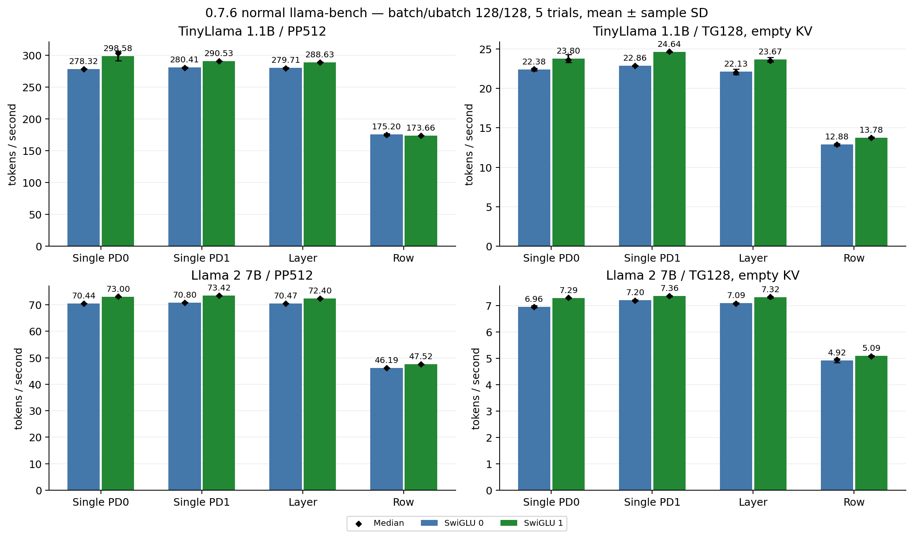
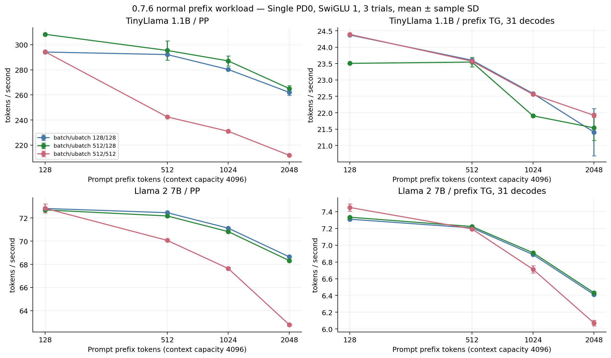
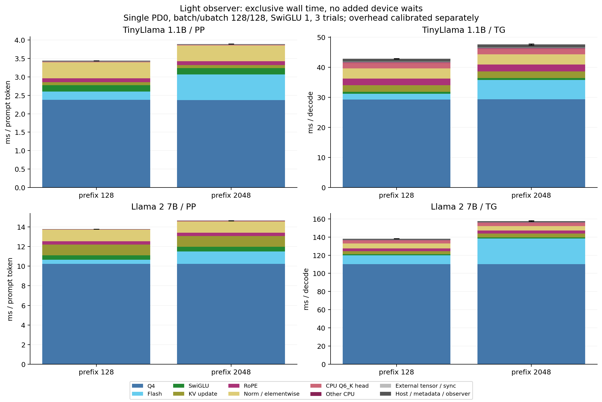

# Kunlun K200 0.7.6：LLM全体プロファイリング

測定日：2026-10-28 JST。性能改善のカーネル実装・既定値変更は行わず、安定版を固定して計測した。

## 1. 結論と次の実装

**最優先は共通Q4経路である。** 軽量診断ではQ4 GEMV/GEMMがPPの約61〜74%、TGの約62〜80%を占めた。CPU Q6_K出力層だけのXPU化より、Q4のActivation量子化再利用とMAC/DMA段階の改善の方が大きい余地がある。

次の最初の実装には、**QKVとFFN gate/upで同一Activationの量子化結果を共有する、明示的なPD別Lease/API**を提案する。既存の量子化計算そのものを変えずに、重複するK/V/upの量子化を省く。全runtime診断で求めた楽観的な全体増速上限は、PP約7〜10%、TG約4〜8%。追加の所有権管理や同期費用があるため、この値を実装後の予測速度とはしない。

長contextの次点はAttentionで、prefix2048のTGではTiny約13.5%、7B約18.0%。Row Splitには、Q4の両PD逐次実行に加え、1D norm重みMULのCPU配置という固有の問題がある。モデルがSingle PDへ収まる今回の条件では、Singleへ切り替える効果が先に得られる。

SwiGLUのXPU実行は今回のSingle/Layer TGでは有利だった。ただし設定間でlogits差と1/32位置のgreedy差を観測した。常時有効化や品質同等を推奨する結果ではない。

## 2. 固定した環境・実装

|項目|固定値|
|---|---|
|library|cbe2be1ae5324edb714472538472f4089e6d9c51 / 0.7.6（演算ソースは8a9db26823a79659b5d7b640558c9d98a378e353と同じ）|
|通常llama.cpp|1e6191a47b24813396238caad9294d570f6f0446|
|計測用GGML commit|a4f96e61b6906f71416bec1d8daebd46447f9fe3|
|submodule|vendor/KunlunK200 → cbe2be1ae5324edb714472538472f4089e6d9c51|
|実機|K200/KL1、PD0/PD1、各HBM8064 MiB、L3 16 MiB、900 MHz|
|SDK/CPU|XRE4.33、XTDK2.7.98.2、i7-8700、CPU threads6、OMP_WAIT_POLICY=PASSIVE|
|KV/feature|F16 K/V、common Q4=1、Attention=1、Flash=1、RoPE=1。Online/KQ/Decoding/Pipeline/KV_DMA/KV_MAXはauto|
|変数|SwiGLU=0/1、Single PD0/PD1・Layer・Row、batch/ubatch=128/128・512/512。PD0のみ512/128も追加|

CPU governor（powersave）、CPU affinity、driver、firmware、clock設定は変更していない。CPU clockは固定していないため、特に小さいprocess間差を過大評価しない。実プロセスのmapsで凍結したlibkunlunk200.so.0.7.6を確認し、通常実行にLD_PRELOAD/TRACE/PROFILE等が混入していないことも確認した。

|モデル|bytes|SHA256|
|---|---|---|
|TinyLlama Q4_0|637699456|da3087fb14aede55fde6eb81a0e55e886810e43509ec82ecdc7aa5d62a03b556|
|Llama 2 7B Q4_0|3825807040|78b8f9777dd620ad29cd2cffb6653b17fa8a5b1fddc1b8821180d60eedd24d48|

GGUFの名称はQ4_0だが、embeddingはCPUのQ4_0 GET_ROWS、出力weightはCPUのQ6_K。全weightがQ4_0ではない。bulk weightはABI v1共通Fのまま、TGはnative GEMV、PPはRows128/Combo4等のSD GEMMを使った。exact_clは全通常条件で0。PP内の一部M=1は最終層の出力行選択・graph pruningによるもので、旧CL fallbackではない。

## 3. 計測の分離と信頼性

通常性能は未改変の安定版ビルド。標準llama-bench PP512/TG128を各5試行、固定prefix128/512/1024/2048を各3試行、warmup後に測った。標準TG128は空KVからの128 decode。prefix試験はcontext容量4096、同一入力・teacher列で31 decode（32位置の最初はPP logits）を測る。両者を直接混ぜない。標準benchのcontext要求はPP512/TG128に応じ、prefix試験とは異なる。

詳細診断は次の3層に分けた。CPU workerのwallは区間和集合を使い、複数threadの経過時間を足さない。XPU演算API・その内側のwait・DMA・enqueueも単純加算しない。

|方式|用途|PP校正負荷 Tiny / 7B|TG校正負荷 Tiny / 7B|
|---|---|---|---|
|全runtime audit|kernel段階、転送bytes/API時間、calls、stream。追加device waitなし|+3.36% / −0.16%|+18.04% / +8.18%|
|軽量observer|主時間内訳とAmdahl。XPU runtime interposeなし|+0.99% / +0.13%|+4.16% / +1.76%|
|head-only|Q6 worker、logits取得、後処理。runtime interposeなし|全体性能の主値に使わない|全体性能の主値に使わない|
|serial/device-clock|補助分離。既存wait追加・profile shader等を使う|通常性能へ加えない|通常性能へ加えない|

校正はprefix128・PD0・SwiGLU=1のABBA順でA/B各6試行。全runtimeではGLU=0も校正した。負荷の負値は測定変動であり、observerが高速化したとは解釈しない。全条件へ一律に補正係数を掛けない。主内訳にも残る軽量observerの負荷を含む。

[測定方法の詳細](METHODS.ja.md)、[通常全表](NORMAL_RESULTS.ja.md)、[軽量主内訳](LIGHT_RESULTS.ja.md)、[全runtime詳細付録](DIAGNOSTIC_RESULTS.ja.md)に、全試行・ms・割合・呼出数・転送・標本SDを保存した。

## 4. 通常PP/TG性能

batch/ubatch128/128。数値は平均 ± 標本SD / 中央値、token/s。各5試行。

|モデル|split|PP512 GLU0|PP512 GLU1|空KV TG128 GLU0|空KV TG128 GLU1|
|---|---|---|---|---|---|
|TinyLlama 1.1B|pd0|278.320 ± 0.146 / 278.275|298.577 ± 7.225 / 303.213|22.382 ± 0.159 / 22.433|23.801 ± 0.506 / 23.630|
|TinyLlama 1.1B|pd1|280.414 ± 0.835 / 279.967|290.527 ± 0.326 / 290.338|22.864 ± 0.057 / 22.876|24.638 ± 0.063 / 24.673|
|TinyLlama 1.1B|layer|279.706 ± 0.891 / 279.481|288.631 ± 0.397 / 288.651|22.127 ± 0.351 / 22.014|23.670 ± 0.287 / 23.493|
|TinyLlama 1.1B|row|175.199 ± 1.554 / 174.544|173.661 ± 0.163 / 173.602|12.878 ± 0.148 / 12.876|13.776 ± 0.073 / 13.768|
|Llama 2 7B|pd0|70.441 ± 0.043 / 70.423|73.004 ± 0.159 / 73.090|6.960 ± 0.045 / 6.959|7.290 ± 0.019 / 7.301|
|Llama 2 7B|pd1|70.804 ± 0.054 / 70.799|73.417 ± 0.084 / 73.421|7.199 ± 0.028 / 7.197|7.362 ± 0.022 / 7.361|
|Llama 2 7B|layer|70.470 ± 0.017 / 70.469|72.401 ± 0.044 / 72.409|7.091 ± 0.023 / 7.081|7.317 ± 0.026 / 7.328|
|Llama 2 7B|row|46.187 ± 0.009 / 46.189|47.518 ± 0.101 / 47.517|4.919 ± 0.072 / 4.957|5.091 ± 0.025 / 5.081|

PD0のGLU有効化は、Tiny PP+7.28%/TG+6.34%、7B PP+3.64%/TG+4.74%。Tiny Row PPは−0.88%で、改善が一律とは言えない。PD0/PD1間にも差があるが、CPU clockを固定していないprocess間比較を含む。

### 固定prefixの通常性能

PD0、GLU=1、128/128、各3試行。PP全体とtokenあたり、TGはdecodeあたりを示す。全Split・全flagの平均/中央値/SDは通常全表を参照。

|モデル|prefix|PP全体 ms|PP ms/token|PP token/s|TG ms/decode|TG token/s|
|---|---|---|---|---|---|---|
|TinyLlama 1.1B|128|435.16|3.3997|294.148 ± 0.666 / 294.526|41.030|24.373 ± 0.018 / 24.376|
|TinyLlama 1.1B|512|1752.60|3.4230|292.137 ± 0.084 / 292.144|42.368|23.602 ± 0.018 / 23.594|
|TinyLlama 1.1B|1024|3653.69|3.5681|280.265 ± 0.580 / 280.460|44.279|22.584 ± 0.008 / 22.588|
|TinyLlama 1.1B|2048|7817.13|3.8170|262.004 ± 2.432 / 260.741|46.751|21.406 ± 0.719 / 21.629|
|Llama 2 7B|128|1757.84|13.7331|72.817 ± 0.094 / 72.856|136.796|7.310 ± 0.002 / 7.309|
|Llama 2 7B|512|7066.53|13.8018|72.454 ± 0.059 / 72.451|138.759|7.207 ± 0.002 / 7.207|
|Llama 2 7B|1024|14398.39|14.0609|71.119 ± 0.024 / 71.131|145.171|6.888 ± 0.003 / 6.887|
|Llama 2 7B|2048|29836.22|14.5685|68.641 ± 0.054 / 68.662|155.988|6.411 ± 0.002 / 6.410|

### batch/ubatchだけで変わる経路

PD0/GLU1/prefix2048で512/512→512/128にすると、Tiny PPは211.928→265.051 token/s（+25.07%）、7B PPは62.787→68.318（+8.81%）、7B TGは6.071→6.432（+5.95%）。Tiny TGは21.920→21.538（−1.74%）。

原因は単なるbatch効率ではない。ubatch512では既存のquery/stride/workspace条件によりPPのFlash/RoPE/CONT等がCPUへ配置される。加えて0.7.6のkv_max_set_rowsはrows>256を拒否し、generic write後のfinite metadataが未検証になる。7BのTGではFlashはGPUで動き続けるが、unverifiedにより疎な最大値再利用へ進まず、SDKによる全KV findmaxが続く。

通常7B GLU1の全prefix累積カウンタは、ub128でhits=11520/unverified=0、ub512でhits=0/unverified=11904。ub512でもFlash calls=16000であり、TG Attention全体のCPU化ではない。TinyのKV幅に対するauto最大値再利用閾値は8192で、今回のprefix範囲には適用されない。K/VのHBM走査bytesをD2H bytesへ読み替えない。

batch512/ub128はこの経路差と、n_batchによるlogits要求・最終層pruningの差を分離する対照である。設定値の既定変更は行わない。

## 5. PP/TGの主時間内訳

軽量observer、PD0・128/128・GLU1、各3試行。単位はPP: ms/prompt token、TG: ms/decode。括弧内は排他的割合。全項目のcalls・SD・区間計は軽量付録へ記録した。

|model|prefix|phase|全体|Q4経路|Flash|SET_ROWS|RoPE|SwiGLU|Q6 CPU graph|Norm+要素/残差|
|---|---|---|---|---|---|---|---|---|---|---|
|tiny|128|pp|3.439|2.381 (69.2%)|0.226 (6.6%)|0.079 (2.3%)|0.107 (3.1%)|0.170 (4.9%)|0.015 (0.4%)|0.435 (12.6%)|
|tiny|128|tg|42.843|29.248 (68.3%)|1.884 (4.4%)|2.178 (5.1%)|2.201 (5.1%)|0.701 (1.6%)|1.773 (4.1%)|3.399 (7.9%)|
|tiny|2048|pp|3.894|2.373 (60.9%)|0.697 (17.9%)|0.078 (2.0%)|0.105 (2.7%)|0.171 (4.4%)|0.015 (0.4%)|0.430 (11.0%)|
|tiny|2048|tg|47.529|29.316 (61.7%)|6.410 (13.5%)|2.184 (4.6%)|2.226 (4.7%)|0.703 (1.5%)|1.797 (3.8%)|3.425 (7.2%)|
|7b|128|pp|13.779|10.234 (74.3%)|0.407 (3.0%)|1.098 (8.0%)|0.331 (2.4%)|0.474 (3.4%)|0.029 (0.2%)|1.171 (8.5%)|
|7b|128|tg|138.233|110.121 (79.7%)|9.841 (7.1%)|3.288 (2.4%)|3.285 (2.4%)|1.058 (0.8%)|3.551 (2.6%)|5.254 (3.8%)|
|7b|2048|pp|14.635|10.229 (69.9%)|1.277 (8.7%)|1.098 (7.5%)|0.330 (2.3%)|0.473 (3.2%)|0.029 (0.2%)|1.167 (8.0%)|
|7b|2048|tg|157.647|110.025 (69.8%)|28.392 (18.0%)|4.299 (2.7%)|3.309 (2.1%)|1.037 (0.7%)|3.565 (2.3%)|5.106 (3.2%)|

TGあたり、Tiny/7BのQ4は154/224回、Flash22/32回、SET_ROWS44/64回、RoPE44/64回、SwiGLU22/32回、RMSNorm45/65回。Q6は1回。PP128もこの演算数で、PP2048は16 microbatch分。shapeごとの実際のnativeカーネル回数は、要素演算数より多い。

支配的なのはQ4のXPU経路であり、CPU Q6_K演算や大容量PCIe転送ではない。ただしこの「XPU経路」はhost引数設定・enqueue・既存waitを含むAPI wallで、純粋なdevice busy率を表さない。

## 6. Q4の量子化・MAC・scale/join

全runtime auditのprefix128、各3試行。追加同期は入れず、元からある完了waitを境界にした。PPのMAC列はGEMMと最終行GEMVの和、scale/joinも両者の和。単位はms/tokenまたはms/decode。

|model|phase|Activation量子化|MAC+DMA（GEMMはblock scale融合）|FP32 scale/sum・slice join|API残余・完了済queue wait|
|---|---|---|---|---|---|
|tiny|pp|0.9401|1.4112|0.0324|0.0068|
|tiny|tg|9.6545|17.5971|3.1985|0.8970|
|7b|pp|2.6520|7.4952|0.0819|0.0099|
|7b|tg|16.4835|83.5021|11.6349|1.4854|

7B TGではMAC+DMAが約83.5 ms、量子化約16.5 ms、scale/sum約11.6 ms。Tinyは約17.6/9.65/3.20 ms。MACのみを高速化した効果と、Q4 API全体を高速化した効果を区別する。GEMM内部のFP16 scale補正をMACから独立に測った値ではない。

### 同じActivationの再量子化

QKVのK/V、FFN upを省略対象としQ/gateを残した実測区間の上限を示す。全部の量子化を消す仮定ではない。Nが異なる経路でActivation pack形式・M chunk・K paddingが一致することも実装時に確認する必要がある。

|model|phase|省略候補区間 ms/単位|全runtime内訳上の費用ゼロ上限倍率|
|---|---|---|---|
|tiny|pp|0.3299|1.105|
|tiny|tg|3.7199|1.081|
|7b|pp|0.9274|1.072|
|7b|tg|6.0510|1.043|

この値にはobserver・host発行も含む。軽量内訳へそのまま加減して新token/sを作らない。MAC・scale/sum・各consumerの完了順は維持し、量子化の算術と共通weight ABIは変えない設計が適切である。

## 7. Attention・周辺演算・同期

実行program名により、Tiny prefix2048 TGはFlash-DecodingのKQ/Online/PV/reduceを各22回/decode、7Bはgrouped K/V shaderとSDNN/CLの複数stream pipelineを確認した。7BではKQ96、PV96、Online128回/decode。共通Q4、RMS、RoPE、SET_ROWS、SwiGLUもdevice上で動く（対応するub128/Single条件）。

既存device-clock probeは通常logitsと全要素ビット一致した。ただしprofile shaderはlegacy DMAやserial実行へ切り替わり、grouped DMA/pipelineの通常性能ではない。KQ/PV内部のDMA・DS・MAC・EW・RS・出力DMA ticks、Online/reduce core ticks、pipeline timeline、host stageは補助CSVへ保存した。core/clusterのticksを足してwallにしない。cross-coreの絶対clock同期も保証していないため、timelineから通常pipelineの重複率を断定しない。

全runtime prefix128 TGのlaunchはTiny1369回、7B1989回、waitは約1445/1967回。enqueue API wallは約2.34/3.39 ms。wait包含時間は約31.29/120.96 msで、その多くは未完了device計算を待つ時間を含む。これを全て削除可能な同期コストとは扱わない。main thread CPU時間もwallへ近く、driver内busy waitを含む。CPU算術が支配的という意味ではない。

scheduler split/allocationの排他的時間は小さい。CPU worker0がmainで走る場合があるため、main CPU時間へ全worker CPU時間を重ねて足さない。other-worker CPU時間を別に残した。

### SET_ROWS/index

7B PP128のSET_ROWSは全runtime診断で約1.105 ms/prompt token。うちlibrary約1.093、index get約0.00885、host layout/index残余約0.00300 ms。PPで次に狙うならindex host loopより、device側の変換・書込み経路が中心になる。

TGではTinyのSET_ROWS約3.04 ms中、index get約0.50 ms、host残余約0.18 ms。7Bは約4.70 ms中、約0.95/0.25 ms。全runtime負荷を含むため、主割合には軽量値を使う。indexをgraph単位で共有できる可能性はあるが、device validation・nonfinite status・KV generationを保持する必要がある。

RMSNorm/要素演算にはalias保護copy_rowsと既存waitがある。全runtimeでその区間を全部ゼロにした上限は、Tiny TG約2.0%、7B約1.0%の全体増速。broadcast weightへのalias等は無条件にin-place化できない。RMSNormとweight MULの融合は別途検証対象である。

## 8. CPU Q6_K出力層・logits後処理

head-only observer、prefix128、各3試行。CPU worker区間和集合とCPU graphを分離した。最終hiddenのD2Hは全runtime診断の別run。logits取得はCPU bufferのmemcpyで、D2Hではない。

|model|CPU MUL_MAT ms/head|CPU graph ms/head|hidden D2H KiB|hidden D2H API ms|logits get ms|greedy等 ms/position|
|---|---|---|---|---|---|---|
|tiny|1.6844|1.7914|8|0.00734|0.00670|0.09475|
|7b|3.3932|3.5174|16|0.01004|0.00588|0.09796|

後処理は32位置分（最初のPP logitsを含む）で、TGの31 decode時間には含めない。CPUスレッド時間を合計すると約6core分になり、これをwallへ加えてはいけない。

出力層の費用ゼロ上限は、軽量診断のTGでTiny約1.039〜1.043倍、7B約1.023〜1.026倍。PPでは約1.002〜1.004倍に留まる。実際のXPU化にはQ6_Kの計算・weight常駐とlogits生成が必要で、CPU greedyを残す場合には32000×F32=128000 bytes（125 KiB）のlogits D2Hが加わる。hiddenの8/16 KiBを消すだけで、総D2Hが減るとは限らない。

## 9. 転送と残るCPU fallback

PD0/GLU1の全runtime診断。要求された論理bytesと転送API wallであり、物理bus全量・kernel内DMAを含まない。単位はKiB/単位とms/単位。PPはprompt token、TGはdecode。P2PはSingleでは0。

|model|prefix|phase|H2D KiB|H2D API ms|D2H KiB|D2H API ms|
|---|---|---|---|---|---|---|
|tiny|128|pp|8.926|0.00965|16.579|0.01294|
|tiny|128|tg|60.279|0.95272|24.688|0.92489|
|tiny|2048|pp|10.674|0.00986|16.579|0.01280|
|tiny|2048|tg|64.281|0.95268|24.688|0.92414|
|7b|128|pp|17.024|0.00746|32.879|0.01973|
|7b|128|tg|80.540|0.50429|49.250|1.35505|
|7b|2048|pp|18.770|0.00762|32.879|0.01964|
|7b|2048|tg|84.540|0.50509|49.250|1.35546|

SwiGLUの効果を同じTG128-prefixの8decode診断で分けると、以下になる。モデルweight初回uploadは入らない。

|model|GLU|H2D KiB/decode|D2H KiB/decode|
|---|---|---|---|
|tiny|0|544.308|992.688|
|tiny|1|60.308|24.688|
|7b|0|1456.597|2801.250|
|7b|1|80.597|49.250|

削減量はTinyでH2D484/D2H968 KiB、7Bで1376/2752 KiB/decode。gate/upとGLU出力の往復が消えている。GLU1の残存D2Hはhidden、KV index/status等が中心で、HBM上のKV本体を毎token CPUへ読む経路ではない（Single ub128）。細かな転送は頻度・同期の影響があり、bytesだけで判断しない。

|条件|確認したCPU算術/処理|
|---|---|
|Single/Layer ub128 GLU1|embedding GET_ROWS、最終層出力選択GET_ROWS、Q6_K出力MUL_MAT。metadata viewも存在|
|GLU0|上記に各層FFN GLUを追加（Tiny22/7B32回/decode）|
|Row GLU1|上記にnorm weight MULを追加（45/65回/decode）|
|ub512 PP|FlashAttention、RoPE/CONT等の対応外条件がCPUへ残る。CPU node一覧に実op/tensorを保存|

### Row Splitの固有ボトルネック

Rowではnorm weightに掛けるMUL（attn_norm/ffn_norm/result_norm）がCPUへ配置される。backendのsplit-buffer制約が非MUL_MATを拒否する条件と整合する。MUL workerの純wall和集合はTiny約0.455 ms、7B約0.689 ms/decodeだが、それらを含むOther CPU graphは約6.83/9.96 ms/decode。threadpool・graph境界等の費用も大きく、MULの算術カーネルだけを速くする対象ではない。

|model|Q4 backend node ms|両PD native Q4 API計 ms|P2P API ms（回/token）|peer ready包含 ms|H2D/D2H/P2P bytes/token|
|---|---|---|---|---|---|
|tiny|61.884|53.988|4.167 (309)|5.948|422775 / 754368 / 2373632|
|7b|170.826|157.930|7.549 (449)|10.106|1131719 / 2163968 / 7290880|

prefix128/GLU1/ub128、1試行8decodeの全runtime診断。P2PはQ4 nodeやpeer readyに包含されるので表の時間を全て足さない。Q4はowning PDとother PDのAPIを順に完了させ、Activation量子化・scale/sum等も両方で行う。両PDがあるだけで並列にはならない。

容量上Rowが必要なら、非分割1D norm weightのowning PD上でのMUL配置が、比較的狭い改善候補である。Other CPU graph＋外部転送等を費用ゼロにした粗い上限は約6〜10%程度の増速余地だが、置換後のGPU演算・転送・observer負荷を無視しており予測ではない。両PD Q4の非同期化はさらに大きい構造変更で、runtime引数設定、PD別L3 Lease、出力joinの安全な設計が必要。

Layerは容量を分けるが、単一リクエストの層は順番に実行するため、今回Singleを大幅に上回らない。モデルが収まるならSingleの選択を先に検討する。

## 10. メモリ・ロード・常駐

|PD0 / GLU1 / ctx4096|Tiny|7B|
|---|---|---|
|Q4 payload bytes|544997376|3642753024|
|common weight regions / uploads|154 / 154|224 / 224|
|CPU pack ms（当該通常process）|1443.050|9481.964|
|weight H2D upload ms|90.963|559.790|
|driver HBM sampled peak MiB|698|5656|
|CPU RSS sampled peak MiB|632.8|3688.6|
|common HBM workspace bytes|4959232|9863168|
|Combo slice scratch bytes（workspace内）|4194304|8388608|
|共有L3 reserve max bytes|10616832|12713984|

pack/uploadはモデルロード中に一度だけで、PP→TGの再pack・再uploadはない。4.5bpw payloadと総HBMを混同しない。L3はcommon Q4とAttention等で共有するため、各APIのreserve値を足さない。slice scratchもworkspaceへ重ねて足さない。driver peakは0.5秒サンプリングで短いpeakを逃し得る。

CPU RSSにはfallback用の元Q4_0 shadow等を含む。診断event保存RAMは通常の必要メモリとして扱わない。GLU0/1、Single/Layer/Rowの両PD peak・RSSは通常全表、API memory counterは診断log、model/backend/context初期化時間はloads.csvへ保存した。初期化は各process1回で、冷たいfile cacheの統計ではない。

## 11. Amdahlによる全体効果の上限

排他的割合f、対象区間の仮倍率rに対し `S = 1/(1-f+f/r)`。下表は軽量observerの同一条件での仮定であり、通常token/sへそのまま掛ける実装後予測ではない。Q4全体とMACだけの高速化を区別し、複数候補の効果を単純合成しない。

|model|prefix|phase|Q4 API全体を2倍|Flash API全体を2倍|Q6 CPU graph費用ゼロ|
|---|---|---|---|---|---|
|tiny|128|pp|1.529|1.034|1.004|
|tiny|128|tg|1.518|1.022|1.043|
|tiny|2048|pp|1.438|1.098|1.004|
|tiny|2048|tg|1.446|1.072|1.039|
|7b|128|pp|1.591|1.015|1.002|
|7b|128|tg|1.662|1.037|1.026|
|7b|2048|pp|1.537|1.046|1.002|
|7b|2048|tg|1.536|1.099|1.023|

MAC+DMA段階だけを2倍にした全runtime上の目安は、PPでTiny約1.25倍/7B約1.37倍、TGで約1.22倍/1.40倍（prefix128）。device DMA・launch/waitを含む段階を丸ごと半減する楽観的な仮定で、純MAC命令を2倍にすれば達成する値ではない。

## 12. 優先順位

|優先|候補|今回の根拠・期待余地|難度・条件|
|---|---|---|---|
|0|Single選択・ubatch128|測定済み。512/512→512/128の長PPでTiny+25.1%、7B+8.8%、7B TG+6.0%|低。Tiny TGは同条件で−1.7%。一律変更しない|
|1|QKV/gate-up Activation量子化の共有|実測区間のゼロ費用上限でPP+7〜10%、TG+4〜8%|中。明示Lease、PD/type/stride/Kpadding/Mchunk/世代検査。算術とABIを維持|
|2|Q4 MAC/DMA供給・発行の改善|最大区間。段階全体2倍の仮定で全体約1.22〜1.40倍|高。最初に主要K/N、M1/128の安定APIで比較。旧pack二重常駐は避ける|
|3|長context Attention|prefix2048 TGで全体の13.5/18.0%。API全体2倍なら約+7.2/+9.9%|高。grouped DMA/pipelineを保つ。今回のlegacy profileの内訳を直結しない|
|Row限定|norm weight MULのdevice配置|45/65 CPU graph境界と往復。粗いゼロ費用上限で約6〜10%|中。非分割1D weightだけを限定して扱う。Row Q4逐次実行は別|
|4|7B PP SET_ROWSの変換・書込み|PP約7.5〜8%。全区間2倍なら全体約+4%|中〜高。index host loopではなくlibrary/device経路が中心|
|5|Norm/要素融合・aliasコピー精査|TGのalias copy全除去上限約+1〜2%。Norm+要素全体半減なら数%|中。in-placeの安全性を一律に仮定しない|
|6|Q6_K outputのXPU化|TGで費用ゼロでも約+2.3〜4.3%、PPは0.5%未満|高。Q6形式・HBM・new logits D2H・CPU greedyの費用が必要|
|用途依存|SwiGLU常時XPU|Single/Layer TGで実測改善、転送を大きく削減|既存opt-inを維持。品質同等ではなく、Tiny Row PPも改善せず|

最初の量子化共有は、入力pointerだけのcacheにしない。GGMLが再利用するbufferの同一アドレスでも内容は変わる。ライブラリに量子化済ActivationのLeaseを持ち、GGML側で同じ実入力・更新世代・owning PDを束ねる。weight handleとworkspaceの寿命は分離したまま、既存kernel/scale結果とのビット比較、PP→TG、Split、state reuseを確認する。共有できない形状は現行経路へ戻す。

## 13. 精度・回帰・安全性

通常/全runtime observerの校正12組×32位置、軽量observer6組×32位置で全logitsビット一致。両モデルGLU0/1の32位置greedyとKV state restoreの次logitsも通常/診断で一致し、default-offビルドのGLU1生成も一致した。全36構成・4prefixの診断先頭9位置は通常3試行の予測と全て一致した。これは同じ設定内の比較である。

### SwiGLU設定間の差

|model|logits NMSE|平均KL CPU→XPU|最大KL|最大絶対差|greedy一致|
|---|---|---|---|---|---|
|tiny|0.00062902897|0.0024792709|0.020686991|1.132323|31/32|
|7b|0.003137678|0.0016346896|0.0088042469|1.393045|31/32|

同じteacher入力、通常ビルド、prefix128。各6試行で同じ差を再現した。CPU SIMD SiLUとdevice scalar libmの丸め差、後段A8閾値等による増幅可能性は既存swiglu.mdにも注意があるが、今回の層別原因は未特定であり断定しない。PPLを再測定した結果ではない。既定値変更・品質同等の結論は出さない。observerによる追加差は0。

通常測定は最高60℃、900 MHz。両PDは終了時RUNNING/no error、persistent latchなし。新規714/810/RD_OVER_IBUFは発生せず、既存errtaskの履歴（PD0過去alignment probe、PD1 token14）は残した。reset、driver/firmware/clock/OS設定変更は行わない。

利用上限で制御接続が一度終了し、補助診断が途中停止した。両PD・latch・processを読み取り確認し、成功JSONを再利用して未実施分だけ再開した。kernel fault後の無条件再実行ではない。収集ではアーカイブ生成後に完了markerが残らなかったため、プロセス終了・ファイルclose後の転送と全624ファイルSHA256照合で回収を確認した。軽量追加分も63ファイルを照合した。

## 14. 未解決・計測上の限界

- hardware profilerによる物理PCIe/NoC全traffic、純粋なdevice busyとdriver待機の完全分離はない。runtime要求bytesとhost API wallを示した。
- 最適化されたgrouped DMA内部のMAC/DMA比やcross-core clock同期を未確認。旧DMA/profile shaderのticksは通常0.7.6の内訳ではない。
- 詳細な全構成traceは各長さ1試行8decode、代表主内訳は3試行。全構成の診断割合を精密な統計として扱わない。通常速度は全構成で複数試行。
- CPU clockを固定していない。同一process内SDは、日間・process間分散を網羅しない。
- TG prefix試験は31decode。標準空KV TG128と区別し、context容量4096・prefix最大2048を超える性能へ外挿しない。
- SwiGLU設定間の品質差、Row norm配置、ub512後のmax metadata再利用不成立は今回修正しない。
- 新カーネル、Q6_K、量子化方式、Attention融合は実装しない。PPL再評価や他モデルへの品質保証も行っていない。

## 15. 変更ファイル・Git・再現

libraryとshaderは無変更。計測source commitではggml/src/k200-diag.h、ggml-backend.cpp、ggml-cpu.c、ggml-kunlun.cpp、llm-smoke.cpp、計測説明を追加・変更した。K200_DIAGNOSTIC_HOOKSを定義した別ビルドのみ有効。default-offでは引数評価・CPU timing wrapperを前処理で除去し、未解決hook参照がないことも確認した。

audit.cpp / head-audit.cpp / node-audit.cppは別shared objectとしてロードする計測器。解析器は時間区間のunion/subtractと最内側owner探索を使う。nested interval/active-callの同値性1000例、実pilotのworker union、既存barrierによるQ4段階合計、排他的partition合計、default-off guardとoverlay検証を通過した。

専用branchは`codex/k200-profile-20261028`。通常の2つのpublication worktreeは開始HEADのままclean、submodule pinもcbe2be1のまま。既存のdirty実験worktreeを変更していない。計測tool・レポートを含む最終commit一覧とHEADは[delivery-summary.json](delivery-summary.json)へ保存する（自己参照hashを避けるためreport commit後に生成）。GitHubへのpush、PR作成、default branch更新は今回行わない。

[ビルド・安全ガード付き実行コマンド](REPRODUCE.ja.md)と各ログJSONのcommand/environmentを参照する。モデル・SDK・ビルド済so/bin・生trace・logitsはGitへ追加しない。weight/model/binary/source hashはbuild-manifest.json、final-measurement-state.json、raw-data-manifest.json、light-manifest.jsonへ保存した。

### 成果物

- [通常性能全表](NORMAL_RESULTS.ja.md)：全36構成、PP128/512/1024/2048、標準PP512/TG128、mean/median/SD、memory/thermal。
- [軽量主内訳](LIGHT_RESULTS.ja.md)：代表8条件のms/割合/calls/SDとAmdahl。
- [全runtime詳細](DIAGNOSTIC_RESULTS.ja.md)：全288区間の上位処理、Q4段階、index、転送、CPU fallback、serial kernel。
- [CSV一覧](analysis/)：ordinary-samples/summary、light-wall-partition、light-amdahl、q4-stages、transfers、cpu-workers、overlap、setrows-overhead、bounded-opportunities等。
- Flash補助CSV：flash-intrusive-stages/work/summary、flash-pipeline-timeline。原trace・logits・command JSONは別archiveで保持し、Git対象外。
