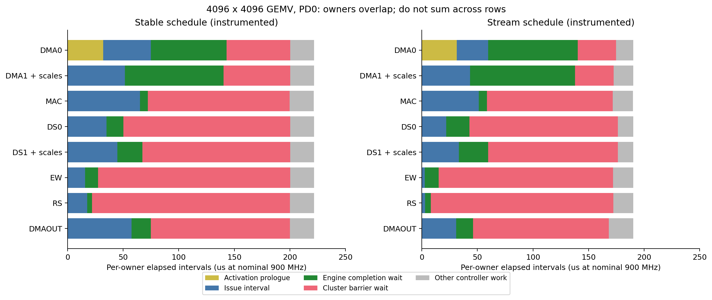
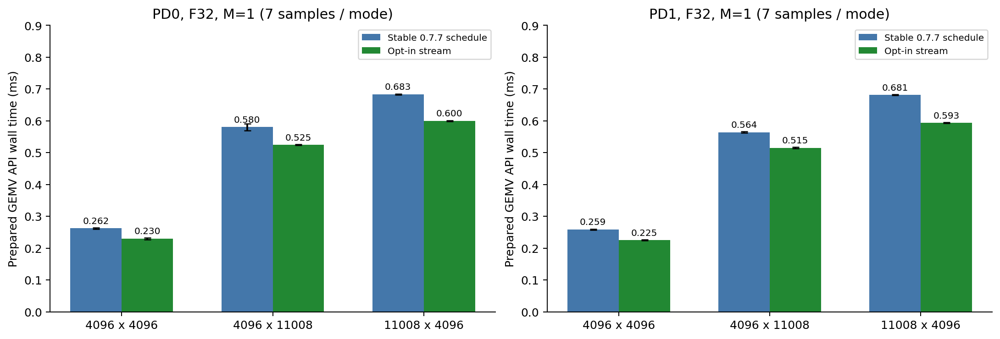
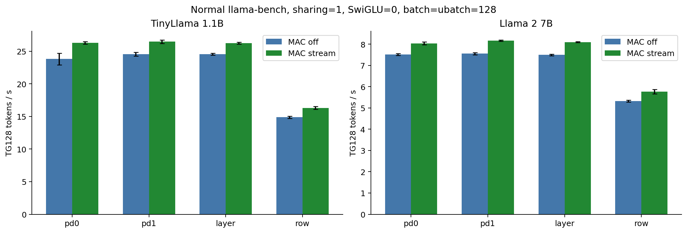
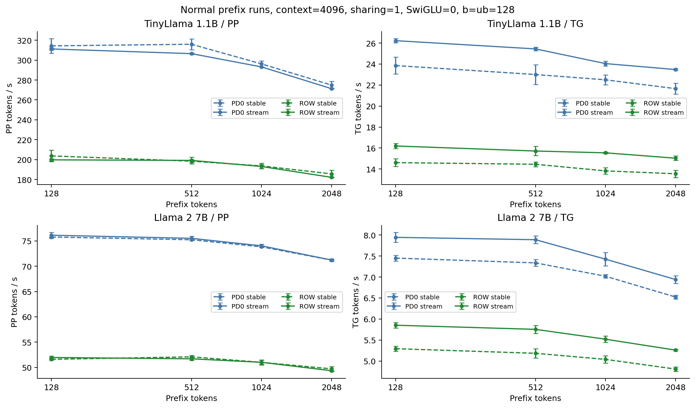

# Kunlun K200 Q4_0 MAC・DMA最適化 実機評価レポート

測定日: 2026-10-29（時刻付き生ログはUTC）。対象: kunlunK200_lib / kunlunK200_llama.cpp。Attentionは0.7.6の実装を保持。

## 1. 結果と適用範囲

主測定（通常実行）では、TinyLlamaのPD0/TG128は23.893から26.291 token/s（+10.04%、各6標本）。Llama 2 7BのPD0/TG128は7.487から7.998 token/s（+6.83%、各6標本）。単体だけでなく通常のLLM全体での変化を確認した。

追加設定は **KUNLUN_Q4_MAC_DMA=1**。0または未設定では0.7.7のGEMVを使う。今回の変更はM=1の共通F GEMVに限り、GEMMのCombined / Wide / Rows64 / Rows128 / Combo2 / Combo4は変更しない。既定設定、GitHub、main/masterには反映していない。

Q4_0重み、ABI v1、FP16 K32 scale、Activationの量子化、量子化共有Lease、MACの演算順序、CL最終和は維持した。従来より高速な結果が得られた範囲だけを明示的なopt-in経路として追加した。

PP高速化は確認しておらず、一部の通常測定では小幅な低下が残る。凍結0.7.7と新ビルドOFFにも差が観測されたため、その比較と凍結版対新ONの直接比較を第10節に分けて示す。既定有効化や安定版buildの置換は行わない。

## 2. 基準版・環境・測定条件

| 項目 | 固定条件 |
| --- | --- |
| 基準ライブラリ | 0.7.7 / 212eedff11b709ce822185f127cb091eec1bc764 |
| 基準llama.cpp | 5d4d138e34da28e63ec6027be70878afa9673c93 |
| 実装ライブラリ | 0.7.8 / a122eb5e983f60dfb053f64fe18de900c0176f01 |
| 測定llama.cpp | 0f64f3aa83f8ec8a787c7f6858e2436f3cc38a08 |
| 開発ブランチ（両方） | codex/k200-q4-mac-dma-20261029 |
| CPU | Intel Core i7-8700 / llama threads=6 / OMP_NUM_THREADS=6 / OMP_WAIT_POLICY=PASSIVE |
| XPU | Kunlun K200 PD0/PD1、900 MHz、変更なし |
| SDK | XTDK 2.7.98.2 / XRE 4.33、ドライバ・firmware・OS設定の変更なし |
| モデル | TinyLlama 1.1B Q4_0 / Llama 2 7B Q4_0、既存の同一GGUF |
| 主評価 | common Q4=1、Activation共有=1、SwiGLU=0、Attention/Flash/RoPE=1、KV F16 |
| PD | Single PD0 / Single PD1 / Layer 1:1 / Row 1:1 |
| batch/ubatch | 128/128、追加比較は512/512（PD0 / Row） |
| 通常性能 | profilerなし、LD_PRELOADなし、診断フックのないRelease実行ファイル |
| 標準ベンチ | llama-bench PP512とTG128を別テスト、各プロセスr=3、設定をABBA反転 |
| prefixテスト | context=4096、固定token IDの先頭128/512/1024/2048、teacher-forcedの31 decode steps（32位置）、warmup=1、r=2、ABBA |

標準llama-benchはソースの to_llama_cparams() に従い n_ctx=n_prompt+n_gen+n_depth を設定する。PP512と空KV側TG128を混ぜてcontext=4096のテストと呼ばない。prefixテストは各長さでKVをクリアし、PP後のKVを保ったTGである。prefixのTG時間はmodel processとlogits取得を含み、argmax・ダンプ・detokenize・表示は外側にある。

基準の実行ファイル、DSO、85組のカーネルは baseline/ に退避した。モデルは全体SHA256を再計算し、CPU設定、ソースcommit、全bin/entry、実行ファイル・DSOのSHAを llm-fixed-manifest.json と library-build-manifest.json に保存した。キャッシュキーもカーネルbin/entryを含めるよう強化した。古い測定を設定名だけで再利用しない。

## 3. 実際のdispatchと演算構造

| 入力M・条件 | 経路 |
| --- | --- |
| M=1、検証済みK/Np、MAC_DMA=1 | 新stream SD GEMV + 従来CL sum |
| M=1、その他のshape / 設定0 | 従来共通F SD GEMV + 従来CL sum |
| M=8 | Combined、Np%512によりNt512/Kt64またはNt256/Kt128 |
| M=32 | Wide、Nt64/Kt256 |
| M=64、Kp<=8192 | Rows64 |
| M=64、Kp>8192 | Combo2 |
| M=128、Kp<=4096 | Rows128 |
| M=128、Kp>4096 | Combo4 |
| 途中のM | 既存の8/32/64/128 paddingとcrop |
| M>128 | 既存の128行chunk。全体M>1の末尾1行もGEMM側へpadding |
| L3不足・確保失敗 | 従来のexact CL fallback。今回の試験対象LLMでは利用回数を別途確認 |
| CDNN / 旧native / direct Q4 / CPU | 従来どおり。新しい共通Fカーネルを誤起動しない |

大きなGEMVでは4 clusterを使用し、各clusterの8 controller coreをmain pipelineのエンジン所有者として分担する。core0=DMAIN0、1=DMAIN1+scale、2=MAC、3=DS0、4=DS1+scale、5=EW、6=RS、7=DMAOUT。prologueではcore0がDMAIN0とDS0を順に使用し、完了fenceと全core barrierを経てmain ownerへ渡す。resident領域の交換前も全main engineをdrainしてから同じ手順へ戻る。CLの並列lane数とSDのMACエンジン数を混同しない。主要形状では4つのMACエンジンに仕事を配る。Np256ではN128単位の割当のため2 clusterが有効である。

診断上の旧entry名 ds_dual16 は、今回固定した0.7.7共通Fカーネルのsymbolである。独立dual16実験の別weight layoutを使った測定ではない。GGML_KUNLUN_NATIVE_Q4=1のみの旧native経路とも区別する。

重みは1 allocationの共通F（固定N32 x K32の16-bit bank-major W4 + K-major FP16 scales）。GEMVは2成分のA8を同じ元Q4_0へ掛け、K32ごとのFP32 partialへscaleを掛け、RSを経てL3へ書く。最後のCL sumは元の順序でK方向を合計する。GEMMは既存Row A8とFP32補正・累積を使う。GEMVとGEMMで量子化精度が同一であるとは主張しない。

~~~mermaid
flowchart LR
 A[Activation HBM] --> Q[従来量子化 / Lease]
 Q --> AD[prologue: DMA + DS]
 AD --> D[L1D resident]
 W[共通F W4 HBM] --> WD[DMAIN0/1]
 WD --> L2[L2 weight double buffer]
 L2 --> DS[DS0/1]
 DS --> LW[L1W]
 D --> MAC[MAC: main + residual]
 LW --> MAC
 S[元FP16 K32 scale] --> SD[DMAIN1 gather / FP32変換]
 SD --> SS[DS1 / L1E 3 slots]
 MAC --> EW[EW scale補正]
 SS --> EW
 EW --> RS[RS]
 RS --> P[L3 FP32 partial]
 P --> SUM[従来CL sum]
 SUM --> Y[出力HBM]
~~~

## 4. 計測手法と限界

通常のLLM測定、公開API単体、SD/CL分離マイクロベンチ、device clock診断、DMA-only診断を分けた。単体は同じ重み・Activation・参照結果を使い、warmup後に順序を反転して測る。量子化済み入力のprepared APIと量子化込みのordinary APIを別々に扱う。

device診断は全32 controllerの get_clock() で発行区間、既存xfenceの完了待ち、既存cluster barrier、prologueを測る。partialと最終出力を通常版とビット比較し、前後guardも検証した。DMA1とDS1の計測はweight側とscale側を合計した所有者区間、prologueはActivation DMAとDSを含む。各ownerの区間は相互に並行しているため、行同士を加算して実行時間としない。「issue」は命令発行・設定・ループ・scoreboard待ちを含み、物理演算器のbusy cycleそのものではない。900 MHzでの時間換算は公称clockに基づく参考値であり、採否にはhost wall timeを使う。物理MACセルのbusy率を取得したものではなく、命令回数を物理セル稼働率として扱わない。

| 計測系列 | 通常SD ms範囲 | 診断時の時間変化率 |
| --- | --- | --- |
| GEMV/GEMMの30形状 | 0.2327–6.4963 | -1.77%–+7.20% |
| 専用化GEMVの6形状 | 0.1972–0.5636 | +2.63%–+4.39% |

負の差はばらつきや計測命令による生成コードの変化を含む。全区間から一定の「計測費用」を差し引く補正は行わない。

LLM診断では既存API/ノード診断を再利用し、既存xpu_waitに直前のlaunch群のラベルを付けた。新しいwait/fenceは挿入しない。1起動直後のwaitと、複数量子化kernelをまとめたwaitを区別する。ノード時間、API時間、wait時間は入れ子なので足し合わせない。診断フックとinterpositionのCPU費用は通常token/sから除外している。

## 5. GEMVのボトルネック

PD0、K=N=4096、cluster0。各列は「旧 → 新」、公称ms。10試行の中央値。

| owner | prologue | issue | 既存fence待ち | barrier待ち | owner全体 |
| --- | --- | --- | --- | --- | --- |
| DMA0 | 0.03203 → 0.03140 | 0.04283 → 0.02836 | 0.06820 → 0.08050 | 0.05718 → 0.03444 | 0.22165 → 0.19017 |
| DMA1+scale | 0.00004 → 0.00001 | 0.05163 → 0.04348 | 0.08861 → 0.09444 | 0.05999 → 0.03464 | 0.22166 → 0.19017 |
| MAC | 0.00004 → 0.00001 | 0.06503 → 0.05119 | 0.00725 → 0.00725 | 0.12759 → 0.11336 | 0.22139 → 0.18990 |
| DS0 | 0.00004 → 0.00001 | 0.03508 → 0.02204 | 0.01514 → 0.02088 | 0.14994 → 0.13340 | 0.22165 → 0.19017 |
| DS1+scale | 0.00004 → 0.00001 | 0.04484 → 0.03324 | 0.02239 → 0.02648 | 0.13298 → 0.11669 | 0.22166 → 0.19017 |
| EW | 0.00004 → 0.00001 | 0.01559 → 0.00270 | 0.01169 → 0.01250 | 0.17299 → 0.15687 | 0.22166 → 0.19017 |
| RS | 0.00004 → 0.00001 | 0.01756 → 0.00299 | 0.00441 → 0.00519 | 0.17796 → 0.16423 | 0.22166 → 0.19017 |
| DMAOUT | 0.00009 → 0.00001 | 0.05733 → 0.03100 | 0.01741 → 0.01498 | 0.12532 → 0.12218 | 0.22166 → 0.19017 |

同じXTDK最適化flagで生成したKL1の静的検査。mm / mm_acc、l2_mov_2d、shuffle、dsmul、rs_rowを確認した。下は各関数全体の静的命令数であり、実行回数ではない。従来entry全体と専用ownerだけの数を、そのまま削減率として扱わない。新entryは外側の1回だけcore_idを読み、owner loopは定数化される。

| 関数 | stack増減byte | lw_lm | sw_lm | core_id |
| --- | --- | --- | --- | --- |
| 従来entry | -384/384 | 142 | 75 | 1 |
| stream entry | -256/256 | 58 | 39 | 1 |
| owner 0 | -128/128 | 30 | 25 | 0 |
| owner 1 | -160/160 | 50 | 34 | 0 |
| owner 2 | -64/64 | 11 | 9 | 0 |
| owner 3 | -32/32 | 2 | 2 | 0 |
| owner 4 | -32/32 | 7 | 7 | 0 |
| owner 5 | -32/32 | 2 | 2 | 0 |
| owner 6 | -32/32 | 4 | 4 | 0 |
| owner 7 | -128/128 | 31 | 27 | 0 |

ソースから再生成した旧GEMVのbin SHA256は233efd022c770ec249f7dbbe1647f0014f3ed67ae4e26f76bbd5f7e32df356e1。新production binはf8d9cda01c084fe1af383b912d161d2d9dbbfd85b7454857809a6a6e90bf5f56で、評価済みspecial128とbyte一致した。全85旧bin/entryもbyte一致している。

リンク済みELFのobjdump結果は baseline:rc=0, selected:rc=0, production:rc=0。compiler assemblyとリンク済み記録は別に保存した。

DMA1は重みの片側に加えてscaleの2D gatherとFP16→FP32変換を担当する。4096 x 4096ではDMA0が4 MiB、DMA1が重み4 MiB+scale1 MiBを読み、両チャネルの仕事量は同一ではない。MAC ownerの完了待ちだけを見ると短いが、発行区間に設定命令と細かなMAC発行費用が含まれる。新方式ではDMA完了待ちの一部が増えてもwall timeは短くなる。発行の密度が上がると待機区間の構成も変わるため、fence待ちだけを改善指標にしない。

従来はK512窓ごとにActivationをL1Dへ供給し、N方向を処理し終えるたびにパイプラインをdrainする。新方式は複数窓を先にL1Dへ置き、連続した作業列として処理する。**Activation・重みの論理読出しbyte数やMAC回数を減らしたものではない**。停止・再充填、barrier、controller内の分岐と無関係な変数の生存範囲を減らす。

| K x Np | W / scale / L3 partial MiB | W / scale descriptors | MAC issue数（2成分） | N64 tasks/cluster | 最長clusterのbarrier回数 |
| --- | --- | --- | --- | --- | --- |
| 4096 x 4096 | 8 / 1 / 2 | 1024 / 256 | 32768 | 16/16/16/16 | 184 → 135 |
| 4096 x 11008 | 21.5 / 2.6875 / 5.375 | 2752 / 688 | 88064 | 44/44/42/42 | 408 → 359 |
| 11008 x 4096 | 21.5 / 2.6875 / 5.375 | 2816 / 704 | 88064 | 16/16/16/16 | 506 → 373 |

追加のソース由来の回数。旧/新で同一。Activation読出しはzero領域の初期化読出しも含む。weight DS列はDS0+DS1の合計、scale DSはDS1に含まれる。

| K x Np | A HBM KiB | A DMA desc | A DS shuffle | DMAOUT desc | weight DS shuffle | scale DS shuffle |
| --- | --- | --- | --- | --- | --- | --- |
| 4096 x 4096 | 96 | 64 | 2048 | 1024 | 16384 | 2048 |
| 4096 x 11008 | 96 | 64 | 2048 | 2752 | 44032 | 5504 |
| 11008 x 4096 | 268 | 184 | 5504 | 2816 | 44032 | 5632 |

表のbyte数・descriptor数はソースから導いた論理値で、物理HBM transaction数ではない。weight DMAは通常8 KiB（最後の半窓は4 KiB）。scale DMAは256 byte幅、K32方向にstride=2*Np、最大16行を1 descriptorで集め、L2側ではFP32へ広げる。partialの出力は128 byte幅の2D転送でL3へ書くため、HBM書戻し量に加算しない。

| PD | channel数 | 8KiB論理GB/s | 16KiB論理GB/s | 32KiB論理GB/s |
| --- | --- | --- | --- | --- |
| PD0 | 1 | 42.66 | 60.78 | 75.56 |
| PD0 | 2 | 82.55 | 104.20 | 134.13 |
| PD1 | 1 | 43.64 | 62.27 | 74.94 |
| PD1 | 2 | 83.10 | 108.46 | 134.71 |

32 KiB burstをそのまま本番の各weight bufferへ使うと、既存の二重bufferやL2_1のscale cacheと競合する。帯域値だけで転送を大型化せず、今回は元のDMA幅とbuffer寿命を維持した。

DMA-onlyは専用の安全な上限付きL2読出し試験であり、contiguous burst、再読出し、1/2 channelを比較した。Q4本体のstrided scale、DS、MAC、EW、RS、L3書込を含まない。したがって値を物理HBMの到達帯域と呼ばない。Q4本体の論理weight byte/SD wall timeとの比較から、単純なHBM容量だけでは説明できず、転送粒度・発行・依存待ち・pipeline停止が改善対象だと判断した。

各clusterの全core中の最大timer。論理仕事が同量でも、DMA完了や配置の差で実時間が一致しない。

| PD | K x N | tasks C0/C1/C2/C3 | device ms C0/C1/C2/C3 | 最大/最小の差 |
| --- | --- | --- | --- | --- |
| PD0 | 11008 x 4096 | 352/352/352/352 | 0.5244/0.5446/0.5380/0.5382 | 3.85% |
| PD0 | 4096 x 11008 | 352/352/336/336 | 0.4551/0.4601/0.4384/0.4414 | 4.95% |
| PD0 | 4096 x 4096 | 128/128/128/128 | 0.1902/0.1999/0.1959/0.1940 | 5.12% |
| PD1 | 11008 x 4096 | 352/352/352/352 | 0.5127/0.5278/0.5209/0.5161 | 2.96% |
| PD1 | 4096 x 11008 | 352/352/336/336 | 0.4407/0.4448/0.4236/0.4283 | 5.00% |
| PD1 | 4096 x 4096 | 128/128/128/128 | 0.1867/0.1934/0.1899/0.1888 | 3.56% |

## 6. GEMMは別の制約を持つ

共通F feederのDMA geometry（1 Nt/Kt tileあたり、ソースから導いた値）。Wは1つの2D descriptorでN32 tileを集め、source pitch=Kp*16 byte。scaleは1つの2D descriptorでK32 blockを集め、source pitch=Np*2 byte、L2側はFP32へ変換する。

| family | Nt/Kt | W: rows x 幅byte | W総byte | scale: rows x 幅byte（HBM） |
| --- | --- | --- | --- | --- |
| Combined512 | 512/64 | 16 x 1024 | 16384 | 2 x 1024 |
| Combined256 | 256/128 | 8 x 2048 | 16384 | 4 x 512 |
| Wide | 64/256 | 2 x 4096 | 8192 | 8 x 128 |
| Rows64 / Combo2 | 64/128 | 2 x 2048 | 4096 | 4 x 128 |
| Rows128 / Combo4 | 32/128 | 1 x 2048 | 2048 | 4 x 64 |

PD0。SD/joinは通常wall中央値、MAC/EW/RSは診断owner内の区間（issueと既存完了待ちを含む、公称ms）。sliceを使わない場合のjoin欄は空呼出し計測費用であり、CL起動ではない。

| K x N | M | SD ms | join ms | MAC owner ms | EW owner ms | RS owner ms |
| --- | --- | --- | --- | --- | --- | --- |
| 4096 x 4096 | 8 | 0.258 | 0.001 | 0.129 | 0.226 | 0.001 |
| 4096 x 4096 | 32 | 1.077 | 0.001 | 0.352 | 0.937 | 0.003 |
| 4096 x 4096 | 64 | 1.712 | 0.001 | 0.695 | 1.291 | 0.006 |
| 4096 x 4096 | 128 | 2.750 | 0.001 | 1.390 | 2.021 | 0.011 |
| 4096 x 11008 | 8 | 0.725 | 0.001 | 0.391 | 0.618 | 0.002 |
| 4096 x 11008 | 32 | 2.777 | 0.001 | 0.946 | 2.518 | 0.009 |
| 4096 x 11008 | 64 | 4.027 | 0.001 | 1.868 | 3.470 | 0.015 |
| 4096 x 11008 | 128 | 6.469 | 0.001 | 3.736 | 5.431 | 0.030 |
| 11008 x 4096 | 8 | 0.685 | 0.001 | 0.346 | 0.608 | 0.001 |
| 11008 x 4096 | 32 | 2.603 | 0.001 | 0.946 | 2.472 | 0.003 |
| 11008 x 4096 | 64 | 3.807 | 0.099 | 1.868 | 3.451 | 0.011 |
| 11008 x 4096 | 128 | 6.496 | 0.319 | 3.649 | 5.339 | 0.045 |

M32以上ではK32 scale補正とFP32累積を行うEWの区間が大きい。M8ではDS供給とEWの発行費用も目立つ。DMA、MAC、EWは重なるため「EW時間+MAC時間」をkernel時間としない。

今回、M1で有効だった大きなresident領域をM>1へそのまま広げない。Rows/Comboは既にL1D 512 KiB、L1E容量、K slice、scratchの制約を持つ。FP32累積順序を変える融合や未検証のfence削除も採用しなかった。全85旧カーネルのbin/entryが基準版と一致しており、PP用MAC処理を変更していない。

## 7. 実装とメモリ所有権

- stream_owner<cid> の8つの専用ループで内側のcore判定を除く。cluster内の全coreは同数の既存syncを実行する。
- 最大128 K32 blocksをresidentにし、L1Dのアドレス計画上の占有範囲をclusterあたり最大64 KiBから512 KiBへ広げる。K2048の場合は256 KiB。resident_l1d_bytesはstream使用時のclusterあたりhigh-waterであり、4 clusterの合計値ではない。旧経路のAPI値0はSRAM使用量が0という意味ではない。次のresident領域へ移る前に全エンジンをdrainする。
- 2つのweight buffer、2つのscale cache、3つのL1E scale slotを維持する。DS→MAC→EWのscale寿命を短縮しない。
- 各K32 partialのmain MAC→residual MAC_ACC→weight-scale EW→RSと、CL sumの順序を維持する。
- SDKのxfence_unlockは複文macroであるため、条件付き呼出しは必ずbrace内に置く。fenceは削除しない。
- 公開weight/Lease/workspaceの所有権と世代判定を変えない。既存runtime mutexと完了waitによってPDごとのSRAM再使用前の完了を保証する。新しい非同期並列APIを追加したものではない。
- CommonQ4MacStatistics と mac_statistics() を別APIとして追加した。既存CommonQ4Statisticsの構造体サイズ、workspace/LeaseのPImplサイズは変更しない。

各clusterのアドレス計画（padding・間隙を含むhigh-water）は次のとおり。論理アドレス範囲と物理HBM allocationを混同しない。

| 領域 | 旧 | 新 | 所有権・上限 |
| --- | --- | --- | --- |
| L1D | 最大64 KiB | 最大512 KiB | resident group内で読出し専用。既存budget512 KiB以内 |
| L1W | 32 KiB span | 同じ | weightの2 buffer、既存DS/MAC完了条件 |
| L1E | 28 KiB span | 同じ | MAC slot + scale 3 slot。既存budget256 KiB以内 |
| L2_0 | 24 KiB high-water | 同じ | weight 2 buffer。A prologueとのaliasはphaseで排他 |
| L2_1 | 32 KiB span | 同じ | 下16 KiB weight、上16 KiB scale cache 2面 |
| L2R | 12 KiB high-water | 同じ | RS/DMAOUTの既存2 buffer配置 |
| L3 partial | Np*Kp/32*4 byte | 同じ | 主要形状2 / 5.375 MiB。既存16 MiB容量判定を維持 |
| HBMのA/scale/rest/slice | 従来workspace | 同じ | Lease・workspaceの寿命を分離した既存管理 |

新しいprogramは7960 byte、loaderのHBM確保は8448 byte/使用workspace・PD。従来programの4864 byteから固定モードで置換されると差は3584 byteである。両経路を同じworkspaceで切り替える単体ベンチでは双方を保持するため、追加分は8448 byteになる。実LLMのallocation計測と区別する。L1Dはkernelのオンチップ資源であり、HBM常駐重みの増加ではない。共通GEMVとFlashのL3は既存のPD別共有poolを再使用するため、各workspaceが示す要求サイズを足して総L3使用量としない。共有poolのpeakはallocation計測で示す。

対応shapeはK=Kpかつ以下のNpのみ。他は理由を記録して従来GEMVへ戻る。入力型・alignment・ABI・重なりは従来APIで先に検査する。

| K | 検証済みNp |
| --- | --- |
| 2048 | 256 / 1024 / 2048 / 2816 / 5632 |
| 4096 | 256 / 2048 / 4096 / 5632 / 11008 |
| 5632 | 1024 / 2048 |
| 11008 | 2048 / 4096 |

## 8. 候補の比較と不採用理由

第1比較系列: 汎用ループ、PD0/F32、15標本、SD ms。下の第2比較系列と絶対時間をpoolしない。

| K x N | 基準 | scale hoistのみ | resident128のみ | resident128の時間変化 |
| --- | --- | --- | --- | --- |
| 4096 x 4096 | 0.260011 | 0.264558 | 0.247435 | -4.84% |
| 4096 x 11008 | 0.533282 | 0.544359 | 0.558178 | +4.67% |
| 11008 x 4096 | 0.644857 | 0.657176 | 0.611273 | -5.21% |

第2比較系列（担当別ループ）:

同一8候補比較系列、PD0/F32、SD wall中央値ms。値の小さい方が速い。

| K x N | 基準 | 汎用cache128+hoist | 専用owner16 | 専用owner64 | 専用owner128採用 | 採用の時間変化 |
| --- | --- | --- | --- | --- | --- | --- |
| 4096 x 4096 | 0.255119 | 0.241776 | 0.242935 | 0.226550 | 0.222997 | -12.59% |
| 4096 x 11008 | 0.532549 | 0.554419 | 0.497336 | 0.480585 | 0.479977 | -9.87% |
| 11008 x 4096 | 0.651206 | 0.612326 | 0.614998 | 0.575599 | 0.571056 | -12.31% |

cache増量だけの汎用ループはN11008で実際に遅くなった。owner専用化を組み合わせたspecial128は主要形状全体で改善した。scale設定のhoistは命令数削減の見込みだけでは採用せず、実測により外した。N-major prototypeはbitwise検証に合格したが、追加差は小さく、一部は逆転し、LLM全体の改善を検証していないため本番に含めない。

新しいweight ABI、再pack、重みの二重常駐、大規模なDMA double buffering、未検証の非同期化、driver変更はいずれも実施していない。

## 9. ライブラリ単体の精度・性能

公開APIの152ケースに合格した。両PD、F32/F16、主要3形状、M=1/8/32/64/128/129/512、実モデル/Rowのshape、N128のcrop、ゼロ・外れ値、K端数と非対応Nを含む。出力全byte、前後guard、Lease量子化値/scale、常駐weightの不変、upload=1、無効設定のfallbackを確認した。GGML側のQ4 F16 Activationは従来のsupports_op条件を維持し、対応外はCPUへ戻る。旧0.7.7でコンパイルしたCPU参照clientの20ケースとLease clientの4ケースも新DSOで実行できた。

M=1/F32、7標本。各値は平均 / 中央値 ± 標本SD（ms）。ordinaryは量子化込み、preparedは既存LeaseからSD+CL処理（API費用込み）。

| PD | K x N | ordinary旧 | ordinary新 | prepared旧 | prepared新 | prepared旧/新 min–max | prepared時間変化 |
| --- | --- | --- | --- | --- | --- | --- | --- |
| PD0 | 4096 x 4096 | 0.3215 / 0.3212 ± 0.0032 | 0.2892 / 0.2892 ± 0.0012 | 0.2621 / 0.2632 ± 0.0017 | 0.2301 / 0.2302 ± 0.0028 | 0.2596–0.2637 / 0.2266–0.2350 | -12.56% |
| PD0 | 4096 x 11008 | 0.6425 / 0.6359 ± 0.0107 | 0.5807 / 0.5808 ± 0.0028 | 0.5800 / 0.5753 ± 0.0105 | 0.5245 / 0.5250 ± 0.0014 | 0.5723–0.5958 / 0.5225–0.5261 | -8.74% |
| PD0 | 11008 x 4096 | 0.8184 / 0.8168 ± 0.0049 | 0.7312 / 0.7318 ± 0.0038 | 0.6829 / 0.6834 ± 0.0016 | 0.5996 / 0.5993 ± 0.0018 | 0.6808–0.6851 / 0.5978–0.6032 | -12.30% |
| PD1 | 4096 x 4096 | 0.3193 / 0.3189 ± 0.0019 | 0.2840 / 0.2839 ± 0.0007 | 0.2587 / 0.2587 ± 0.0012 | 0.2250 / 0.2250 ± 0.0012 | 0.2573–0.2605 / 0.2234–0.2269 | -13.03% |
| PD1 | 4096 x 11008 | 0.6239 / 0.6238 ± 0.0016 | 0.5768 / 0.5768 ± 0.0020 | 0.5637 / 0.5631 ± 0.0019 | 0.5148 / 0.5152 ± 0.0020 | 0.5614–0.5663 / 0.5114–0.5172 | -8.51% |
| PD1 | 11008 x 4096 | 0.8162 / 0.8161 ± 0.0022 | 0.7279 / 0.7274 ± 0.0012 | 0.6810 / 0.6803 ± 0.0018 | 0.5935 / 0.5939 ± 0.0021 | 0.6799–0.6849 / 0.5910–0.5957 | -12.69% |

両PD・F32/F16の最大NMSE。quant差分数は量子化値のCPU参照との差。

| K x N | M | ケース数 | 実装NMSE | 量子化NMSE | 総NMSE | CPU quant差分 |
| --- | --- | --- | --- | --- | --- | --- |
| 4096 x 4096 | 1 | 4 | 4.321e-14 | 2.388e-10 | 2.387e-10 | 0 |
| 4096 x 11008 | 1 | 4 | 4.507e-14 | 2.462e-10 | 2.462e-10 | 0 |
| 11008 x 4096 | 1 | 4 | 1.163e-13 | 2.330e-10 | 2.335e-10 | 0 |
| 4096 x 4096 | 8 | 4 | 1.681e-15 | 1.542e-05 | 1.542e-05 | 0 |
| 4096 x 4096 | 128 | 4 | 1.664e-15 | 1.548e-05 | 1.548e-05 | 0 |

implementation_nmseはCPUで同じ量子化済みActivationを使った参照との差、quantization_nmseは元Q4_0/入力に対する量子化由来の差である。両者を同じ精度誤差として扱わない。GEMVの2成分A8とGEMMのRow A8の差は維持している。

## 10. 通常LLM性能

主比較は同一実行ファイル・同一DSOでMAC_DMAだけを切り替える。各点は2プロセス x 3試行=6標本。PD0/Row・ub128ではActivation共有の2x2 factorialを前後反転した。他の主比較はABBA。標準偏差は標本標準偏差、改善率は中央値のtoken/s比である。

| モデル | Split | b/ub | 処理 | n旧/新 | 旧 平均/中央値±SD token/s | 新 平均/中央値±SD token/s | 中央値改善率 |
| --- | --- | --- | --- | --- | --- | --- | --- |
| TinyLlama | pd0 | 128 | PP | 6/6 | 314.12 / 314.17 ± 5.53 | 310.26 / 307.63 ± 5.33 | -2.08% |
| TinyLlama | pd0 | 128 | TG | 6/6 | 23.81 / 23.89 ± 0.89 | 26.27 / 26.29 ± 0.18 | +10.04% |
| TinyLlama | pd1 | 128 | PP | 6/6 | 314.14 / 313.74 ± 7.94 | 307.18 / 307.11 ± 0.31 | -2.12% |
| TinyLlama | pd1 | 128 | TG | 6/6 | 24.53 / 24.64 ± 0.29 | 26.47 / 26.51 ± 0.26 | +7.59% |
| TinyLlama | layer | 128 | PP | 6/6 | 306.46 / 306.46 ± 1.22 | 305.91 / 305.66 ± 0.52 | -0.26% |
| TinyLlama | layer | 128 | TG | 6/6 | 24.54 / 24.59 ± 0.14 | 26.24 / 26.24 ± 0.13 | +6.69% |
| TinyLlama | row | 128 | PP | 6/6 | 199.84 / 198.33 ± 4.18 | 200.12 / 198.81 ± 3.67 | +0.24% |
| TinyLlama | row | 128 | TG | 6/6 | 14.87 / 14.90 ± 0.17 | 16.30 / 16.29 ± 0.21 | +9.31% |
| TinyLlama | pd0 | 512 | PP | 6/6 | 248.11 / 248.27 ± 0.64 | 247.58 / 247.75 ± 0.60 | -0.21% |
| TinyLlama | pd0 | 512 | TG | 6/6 | 24.53 / 24.52 ± 0.12 | 25.23 / 25.48 ± 1.00 | +3.94% |
| TinyLlama | row | 512 | PP | 6/6 | 177.02 / 176.95 ± 2.94 | 176.13 / 175.64 ± 2.42 | -0.74% |
| TinyLlama | row | 512 | TG | 6/6 | 15.12 / 15.18 ± 0.14 | 15.90 / 15.77 ± 0.28 | +3.88% |
| Llama 2 7B | pd0 | 128 | PP | 6/6 | 75.31 / 75.32 ± 0.06 | 75.26 / 75.25 ± 0.05 | -0.09% |
| Llama 2 7B | pd0 | 128 | TG | 6/6 | 7.51 / 7.49 ± 0.04 | 8.04 / 8.00 ± 0.07 | +6.83% |
| Llama 2 7B | pd1 | 128 | PP | 6/6 | 76.22 / 76.22 ± 0.23 | 75.57 / 75.56 ± 0.03 | -0.87% |
| Llama 2 7B | pd1 | 128 | TG | 6/6 | 7.55 / 7.56 ± 0.05 | 8.17 / 8.18 ± 0.03 | +8.16% |
| Llama 2 7B | layer | 128 | PP | 6/6 | 75.28 / 75.28 ± 0.02 | 75.26 / 75.26 ± 0.02 | -0.02% |
| Llama 2 7B | layer | 128 | TG | 6/6 | 7.49 / 7.50 ± 0.04 | 8.10 / 8.09 ± 0.02 | +7.90% |
| Llama 2 7B | row | 128 | PP | 6/6 | 51.30 / 51.30 ± 0.02 | 51.76 / 51.71 ± 0.50 | +0.82% |
| Llama 2 7B | row | 128 | TG | 6/6 | 5.33 / 5.34 ± 0.04 | 5.77 / 5.77 ± 0.10 | +8.10% |
| Llama 2 7B | pd0 | 512 | PP | 6/6 | 71.58 / 71.56 ± 0.23 | 71.62 / 71.63 ± 0.15 | +0.10% |
| Llama 2 7B | pd0 | 512 | TG | 6/6 | 7.47 / 7.48 ± 0.04 | 8.02 / 8.04 ± 0.07 | +7.47% |
| Llama 2 7B | row | 512 | PP | 6/6 | 49.72 / 49.65 ± 0.21 | 49.74 / 49.72 ± 0.10 | +0.15% |
| Llama 2 7B | row | 512 | TG | 6/6 | 5.33 / 5.37 ± 0.05 | 5.82 / 5.80 ± 0.07 | +8.17% |

主比較のTG中央値改善率は+3.88%〜+10.04%。PPの表示上の差は-2.12%〜+0.82%で、11/12構成は平均差が両条件の標準偏差の二乗和平方根以内だった。この単純な幅は有意差検定ではない。各6試行は2プロセスに属し、同一プロセス内の相関もある。PPの小差をカーネル改善として採用せず、全標本と別系列の凍結版controlも併記する。

| モデル | Split | 共有 | MAC新 | PP 平均/中央値±SD | TG 平均/中央値±SD | TG対00改善 |
| --- | --- | --- | --- | --- | --- | --- |
| TinyLlama | pd0 | 0 | 0 | 279.73 / 279.89 ± 0.61 | 22.30 / 22.52 ± 0.45 | +0.00% |
| TinyLlama | pd0 | 0 | 1 | 278.98 / 278.93 ± 0.58 | 24.02 / 24.04 ± 0.14 | +6.74% |
| TinyLlama | pd0 | 1 | 0 | 314.12 / 314.17 ± 5.53 | 23.81 / 23.89 ± 0.89 | +6.11% |
| TinyLlama | pd0 | 1 | 1 | 310.26 / 307.63 ± 5.33 | 26.27 / 26.29 ± 0.18 | +16.76% |
| TinyLlama | row | 0 | 0 | 170.00 / 169.93 ± 0.27 | 13.26 / 13.28 ± 0.08 | +0.00% |
| TinyLlama | row | 0 | 1 | 173.95 / 173.23 ± 4.90 | 14.20 / 14.31 ± 0.30 | +7.79% |
| TinyLlama | row | 1 | 0 | 199.84 / 198.33 ± 4.18 | 14.87 / 14.90 ± 0.17 | +12.22% |
| TinyLlama | row | 1 | 1 | 200.12 / 198.81 ± 3.67 | 16.30 / 16.29 ± 0.21 | +22.67% |
| Llama 2 7B | pd0 | 0 | 0 | 70.57 / 70.53 ± 0.36 | 7.11 / 7.10 ± 0.04 | +0.00% |
| Llama 2 7B | pd0 | 0 | 1 | 70.67 / 70.65 ± 0.29 | 7.69 / 7.69 ± 0.04 | +8.32% |
| Llama 2 7B | pd0 | 1 | 0 | 75.31 / 75.32 ± 0.06 | 7.51 / 7.49 ± 0.04 | +5.45% |
| Llama 2 7B | pd0 | 1 | 1 | 75.26 / 75.25 ± 0.05 | 8.04 / 8.00 ± 0.07 | +12.65% |
| Llama 2 7B | row | 0 | 0 | 46.05 / 46.05 ± 0.02 | 4.95 / 4.96 ± 0.06 | +0.00% |
| Llama 2 7B | row | 0 | 1 | 46.16 / 46.04 ± 0.20 | 5.45 / 5.45 ± 0.01 | +9.83% |
| Llama 2 7B | row | 1 | 0 | 51.30 / 51.30 ± 0.02 | 5.33 / 5.34 ± 0.04 | +7.55% |
| Llama 2 7B | row | 1 | 1 | 51.76 / 51.71 ± 0.50 | 5.77 / 5.77 ± 0.10 | +16.26% |

共有効果とMAC効果は異なる分母から計算する。共有=0/MAC=0に対する組合せ効果を、共有=1におけるMAC単独効果と混ぜない。小さいPP差は誤差と切り分け、M>1 kernelの高速化とは説明しない。

| モデル | Split | b/ub | prefix | PP token/s 旧→新 | PP差 | TG token/s 旧→新 | TG差 |
| --- | --- | --- | --- | --- | --- | --- | --- |
| Llama 2 7B | layer | 128 | 128 | 75.81 → 75.92 | +0.15% | 7.38 → 7.98 | +8.10% |
| Llama 2 7B | layer | 128 | 512 | 75.42 → 75.94 | +0.69% | 7.23 → 7.73 | +7.03% |
| Llama 2 7B | layer | 128 | 1024 | 74.02 → 74.31 | +0.39% | 6.92 → 7.36 | +6.34% |
| Llama 2 7B | layer | 128 | 2048 | 71.37 → 71.46 | +0.13% | 6.38 → 6.81 | +6.78% |
| Llama 2 7B | pd0 | 128 | 128 | 75.75 → 75.93 | +0.24% | 7.45 → 7.96 | +6.87% |
| Llama 2 7B | pd0 | 128 | 512 | 75.24 → 75.43 | +0.26% | 7.34 → 7.93 | +8.01% |
| Llama 2 7B | pd0 | 128 | 1024 | 73.84 → 74.04 | +0.27% | 7.01 → 7.41 | +5.76% |
| Llama 2 7B | pd0 | 128 | 2048 | 71.18 → 71.13 | -0.07% | 6.53 → 6.97 | +6.77% |
| Llama 2 7B | pd0 | 512 | 128 | 75.97 → 75.70 | -0.36% | 7.38 → 8.03 | +8.77% |
| Llama 2 7B | pd0 | 512 | 512 | 71.46 → 71.49 | +0.05% | 7.14 → 7.69 | +7.79% |
| Llama 2 7B | pd0 | 512 | 1024 | 68.62 → 68.55 | -0.11% | 6.72 → 7.21 | +7.23% |
| Llama 2 7B | pd0 | 512 | 2048 | 63.07 → 62.99 | -0.12% | 6.07 → 6.46 | +6.51% |
| Llama 2 7B | pd1 | 128 | 128 | 76.02 → 76.11 | +0.12% | 7.37 → 7.91 | +7.32% |
| Llama 2 7B | pd1 | 128 | 512 | 75.46 → 75.93 | +0.62% | 7.22 → 7.80 | +7.92% |
| Llama 2 7B | pd1 | 128 | 1024 | 74.03 → 74.31 | +0.38% | 6.93 → 7.43 | +7.19% |
| Llama 2 7B | pd1 | 128 | 2048 | 71.35 → 71.40 | +0.06% | 6.45 → 6.87 | +6.51% |
| Llama 2 7B | row | 128 | 128 | 51.53 → 51.82 | +0.55% | 5.30 → 5.88 | +11.00% |
| Llama 2 7B | row | 128 | 512 | 52.08 → 51.74 | -0.65% | 5.18 → 5.78 | +11.56% |
| Llama 2 7B | row | 128 | 1024 | 50.90 → 50.94 | +0.09% | 5.05 → 5.54 | +9.86% |
| Llama 2 7B | row | 128 | 2048 | 49.64 → 49.35 | -0.60% | 4.82 → 5.26 | +9.01% |
| Llama 2 7B | row | 512 | 128 | 51.53 → 51.54 | +0.00% | 5.35 → 5.93 | +10.77% |
| Llama 2 7B | row | 512 | 512 | 49.68 → 49.99 | +0.63% | 5.21 → 5.69 | +9.24% |
| Llama 2 7B | row | 512 | 1024 | 48.16 → 48.44 | +0.58% | 4.99 → 5.40 | +8.22% |
| Llama 2 7B | row | 512 | 2048 | 45.42 → 45.47 | +0.11% | 4.62 → 5.02 | +8.72% |
| TinyLlama | layer | 128 | 128 | 312.44 → 318.99 | +2.09% | 24.40 → 25.70 | +5.34% |
| TinyLlama | layer | 128 | 512 | 306.71 → 309.33 | +0.85% | 23.42 → 24.98 | +6.68% |
| TinyLlama | layer | 128 | 1024 | 291.82 → 292.29 | +0.16% | 22.58 → 23.84 | +5.57% |
| TinyLlama | layer | 128 | 2048 | 269.37 → 271.13 | +0.65% | 22.03 → 22.99 | +4.37% |
| TinyLlama | pd0 | 128 | 128 | 310.75 → 310.86 | +0.04% | 23.88 → 26.20 | +9.74% |
| TinyLlama | pd0 | 128 | 512 | 315.57 → 306.34 | -2.92% | 23.22 → 25.49 | +9.80% |
| TinyLlama | pd0 | 128 | 1024 | 295.53 → 293.20 | -0.79% | 22.72 → 24.05 | +5.83% |
| TinyLlama | pd0 | 128 | 2048 | 274.93 → 271.33 | -1.31% | 21.69 → 23.50 | +8.33% |
| TinyLlama | pd0 | 512 | 128 | 311.25 → 311.02 | -0.07% | 24.37 → 26.10 | +7.10% |
| TinyLlama | pd0 | 512 | 512 | 250.40 → 247.37 | -1.21% | 23.19 → 25.12 | +8.29% |
| TinyLlama | pd0 | 512 | 1024 | 239.11 → 236.61 | -1.04% | 21.73 → 24.10 | +10.91% |
| TinyLlama | pd0 | 512 | 2048 | 219.47 → 216.71 | -1.26% | 21.10 → 23.22 | +10.05% |
| TinyLlama | pd1 | 128 | 128 | 311.68 → 318.59 | +2.22% | 24.41 → 25.57 | +4.75% |
| TinyLlama | pd1 | 128 | 512 | 314.40 → 316.02 | +0.51% | 22.91 → 24.54 | +7.09% |
| TinyLlama | pd1 | 128 | 1024 | 296.97 → 301.86 | +1.64% | 22.17 → 23.10 | +4.22% |
| TinyLlama | pd1 | 128 | 2048 | 274.38 → 279.11 | +1.72% | 21.87 → 22.90 | +4.74% |
| TinyLlama | row | 128 | 128 | 203.16 → 199.29 | -1.91% | 14.61 → 16.12 | +10.35% |
| TinyLlama | row | 128 | 512 | 197.84 → 197.63 | -0.11% | 14.53 → 15.73 | +8.25% |
| TinyLlama | row | 128 | 1024 | 192.82 → 192.07 | -0.39% | 13.86 → 15.52 | +12.04% |
| TinyLlama | row | 128 | 2048 | 185.44 → 182.19 | -1.75% | 13.46 → 15.11 | +12.26% |
| TinyLlama | row | 512 | 128 | 201.69 → 199.08 | -1.29% | 14.28 → 16.31 | +14.28% |
| TinyLlama | row | 512 | 512 | 175.27 → 173.61 | -0.95% | 14.56 → 16.00 | +9.91% |
| TinyLlama | row | 512 | 1024 | 168.05 → 168.31 | +0.15% | 14.07 → 15.53 | +10.36% |
| TinyLlama | row | 512 | 2048 | 158.24 → 157.40 | -0.53% | 13.74 → 15.21 | +10.69% |

prefixの各点は2プロセス x 2試行=4標本。PPは全prompt処理、TGはその直後の31 decode stepsである。空KV側TG128と長context TGの値を直接同じ条件として比較しない。平均・中央値・標準偏差・最小最大・全標本は analysis/standard.csv / prefix.csv / llm-results.json に保存した。

凍結0.7.7の実行ファイル/DSOと、新ビルドのMAC=0を独立したABBAで比較。主比較と標本を混ぜない。

| モデル | Split | 処理 | 凍結0.7.7 平均/中央値±SD | 新ビルドOFF 平均/中央値±SD | 差 |
| --- | --- | --- | --- | --- | --- |
| Llama 2 7B | pd0 | pp | 75.24 / 75.23 ± 0.05 | 75.57 / 75.41 ± 0.53 | +0.24% |
| Llama 2 7B | pd0 | tg | 7.40 / 7.40 ± 0.01 | 7.40 / 7.40 ± 0.04 | +0.07% |
| Llama 2 7B | row | pp | 52.30 / 52.36 ± 0.12 | 51.59 / 51.53 ± 0.38 | -1.58% |
| Llama 2 7B | row | tg | 5.21 / 5.21 ± 0.02 | 5.36 / 5.36 ± 0.01 | +2.82% |
| TinyLlama | pd0 | pp | 305.68 / 305.57 ± 0.46 | 306.28 / 306.59 ± 0.79 | +0.33% |
| TinyLlama | pd0 | tg | 24.54 / 24.53 ± 0.14 | 23.38 / 23.31 ± 0.67 | -5.00% |
| TinyLlama | row | pp | 201.88 / 201.63 ± 5.06 | 201.71 / 201.19 ± 5.37 | -0.22% |
| TinyLlama | row | tg | 15.11 / 15.15 ± 0.17 | 14.76 / 14.76 ± 0.24 | -2.55% |

凍結版とのOFF比較にはTinyLlama TGの低下（PD0 -5.00%、Row -2.55%）、7B Row PPの低下（-1.58%）も観測された。旧カーネルが同一であることだけを理由に、ホスト再ビルド後の速度が同等とは断定しない。原因の切り分けは未完であり、実行順序・ホスト側配置・計測変動などの仮説を証明済みの原因として扱わない。この懸念を受け、次の直接比較を追加した。

凍結0.7.7実行ファイル・DSO 対 新ビルド最適化ONの直接ABBA比較。b/ub128、共有1、SwiGLU0、PP512/TG128、各4標本。前記OFF controlや主系列とpoolしない。追加の独立した確認系列である。

| モデル | Split | 処理 | 凍結0.7.7 平均/中央値±SD | 新ON 平均/中央値±SD | 中央値差 |
| --- | --- | --- | --- | --- | --- |
| TinyLlama | pd0 | PP | 305.70 / 305.70 ± 0.18 | 312.85 / 312.91 ± 8.64 | +2.36% |
| TinyLlama | pd0 | TG | 24.45 / 24.45 ± 0.10 | 26.20 / 26.21 ± 0.18 | +7.20% |
| TinyLlama | row | PP | 197.76 / 197.51 ± 0.83 | 197.46 / 197.29 ± 0.49 | -0.12% |
| TinyLlama | row | TG | 15.06 / 15.05 ± 0.18 | 16.33 / 16.32 ± 0.10 | +8.45% |
| Llama 2 7B | pd0 | PP | 75.53 / 75.47 ± 0.37 | 75.41 / 75.28 ± 0.28 | -0.26% |
| Llama 2 7B | pd0 | TG | 7.40 / 7.42 ± 0.05 | 7.91 / 7.92 ± 0.09 | +6.66% |
| Llama 2 7B | row | PP | 51.65 / 51.49 ± 0.51 | 51.31 / 51.30 ± 0.01 | -0.36% |
| Llama 2 7B | row | TG | 5.35 / 5.36 ± 0.03 | 5.94 / 5.94 ± 0.01 | +10.70% |

主系列でPPの小低下、またはTGの広いばらつきが見えた5構成だけを、同じ実行ファイル・設定のABBA（各6標本）で追加確認した。元の系列は削除せず、標本もpoolしない。これは追加の独立した確認系列である。

| モデル | Split | b/ub | 処理 | 旧 平均/中央値±SD | 新 平均/中央値±SD | 中央値差 |
| --- | --- | --- | --- | --- | --- | --- |
| Llama 2 7B | pd1 | 128 | PP | 75.70 / 75.60 ± 0.34 | 76.11 / 76.11 ± 0.64 | +0.68% |
| Llama 2 7B | pd1 | 128 | TG | 7.51 / 7.51 ± 0.07 | 8.10 / 8.11 ± 0.08 | +7.94% |
| TinyLlama | pd0 | 128 | PP | 316.45 / 320.52 ± 6.75 | 310.14 / 308.98 ± 5.65 | -3.60% |
| TinyLlama | pd0 | 128 | TG | 24.30 / 24.35 ± 0.33 | 25.30 / 25.42 ± 0.96 | +4.41% |
| TinyLlama | pd0 | 512 | PP | 249.11 / 248.62 ± 2.21 | 247.42 / 247.36 ± 0.44 | -0.51% |
| TinyLlama | pd0 | 512 | TG | 24.21 / 24.33 ± 0.34 | 26.05 / 26.03 ± 0.13 | +7.01% |
| TinyLlama | pd1 | 128 | PP | 315.28 / 315.34 ± 8.75 | 308.22 / 308.14 ± 0.77 | -2.28% |
| TinyLlama | pd1 | 128 | TG | 24.13 / 24.03 ± 0.58 | 26.34 / 26.44 ± 0.45 | +10.01% |
| TinyLlama | row | 512 | PP | 175.87 / 174.77 ± 2.65 | 175.65 / 174.95 ± 1.73 | +0.11% |
| TinyLlama | row | 512 | TG | 14.99 / 15.07 ± 0.20 | 16.40 / 16.53 ± 0.26 | +9.74% |

追加系列の中央値差はTG +4.41%〜+10.01%、PP -3.60%〜+0.68%。主系列と符号や大きさが揃わない条件も含め、すべての構成で同じ改善率を保証するものとはしない。今回の採用理由はTG側の実測改善であり、PP高速化ではない。M>1カーネルが同一でも、PPの小幅なwall時間の変化をゼロとして扱わず、原因未確定の差として残す。

## 11. 実LLMでの実行経路・同期・転送

prefix128診断。PPは128 tokens全体、TGは1 tokenあたり。Rowは全owner/PDの合計（同じ行列を2PDへ分割するため呼出し数は増える）。

| モデル | Split | MAC新 | phase | 旧SD GEMV | 新SD GEMV | SD GEMM | exact CL | shape fallback |
| --- | --- | --- | --- | --- | --- | --- | --- | --- |
| TinyLlama | pd0 | 0 | PP | 3 | 0 | 151 | 0 | 0 |
| TinyLlama | pd0 | 0 | TG | 154 | 0 | 0 | 0 | 0 |
| TinyLlama | pd0 | 1 | PP | 0 | 3 | 151 | 0 | 0 |
| TinyLlama | pd0 | 1 | TG | 0 | 154 | 0 | 0 | 0 |
| TinyLlama | pd1 | 0 | PP | 3 | 0 | 151 | 0 | 0 |
| TinyLlama | pd1 | 0 | TG | 154 | 0 | 0 | 0 | 0 |
| TinyLlama | pd1 | 1 | PP | 0 | 3 | 151 | 0 | 0 |
| TinyLlama | pd1 | 1 | TG | 0 | 154 | 0 | 0 | 0 |
| TinyLlama | layer | 0 | PP | 3 | 0 | 151 | 0 | 0 |
| TinyLlama | layer | 0 | TG | 154 | 0 | 0 | 0 | 0 |
| TinyLlama | layer | 1 | PP | 0 | 3 | 151 | 0 | 0 |
| TinyLlama | layer | 1 | TG | 0 | 154 | 0 | 0 | 0 |
| TinyLlama | row | 0 | PP | 6 | 0 | 302 | 0 | 0 |
| TinyLlama | row | 0 | TG | 308 | 0 | 0 | 0 | 0 |
| TinyLlama | row | 1 | PP | 0 | 6 | 302 | 0 | 0 |
| TinyLlama | row | 1 | TG | 0 | 308 | 0 | 0 | 0 |
| Llama 2 7B | pd0 | 0 | PP | 3 | 0 | 221 | 0 | 0 |
| Llama 2 7B | pd0 | 0 | TG | 224 | 0 | 0 | 0 | 0 |
| Llama 2 7B | pd0 | 1 | PP | 0 | 3 | 221 | 0 | 0 |
| Llama 2 7B | pd0 | 1 | TG | 0 | 224 | 0 | 0 | 0 |
| Llama 2 7B | pd1 | 0 | PP | 3 | 0 | 221 | 0 | 0 |
| Llama 2 7B | pd1 | 0 | TG | 224 | 0 | 0 | 0 | 0 |
| Llama 2 7B | pd1 | 1 | PP | 0 | 3 | 221 | 0 | 0 |
| Llama 2 7B | pd1 | 1 | TG | 0 | 224 | 0 | 0 | 0 |
| Llama 2 7B | layer | 0 | PP | 3 | 0 | 221 | 0 | 0 |
| Llama 2 7B | layer | 0 | TG | 224 | 0 | 0 | 0 | 0 |
| Llama 2 7B | layer | 1 | PP | 0 | 3 | 221 | 0 | 0 |
| Llama 2 7B | layer | 1 | TG | 0 | 224 | 0 | 0 | 0 |
| Llama 2 7B | row | 0 | PP | 6 | 0 | 442 | 0 | 0 |
| Llama 2 7B | row | 0 | TG | 448 | 0 | 0 | 0 | 0 |
| Llama 2 7B | row | 1 | PP | 0 | 6 | 442 | 0 | 0 |
| Llama 2 7B | row | 1 | TG | 0 | 448 | 0 | 0 | 0 |

同じprefix128、PPは全体ms、TGはms/token。SDのenqueue-completeはlaunch開始から既存wait完了までのhost envelope。実行器busy timeではない。CL列は既存最終和の同じenvelope。Q4 API合計はprepare/ordinary/sharedの互いに別な最上位呼出しのみ。

| モデル | Split | phase | SD 旧→新 ms | SD既存wait 旧→新 ms | CL sum 旧→新 ms | Q4 API 旧→新 ms |
| --- | --- | --- | --- | --- | --- | --- |
| TinyLlama | pd0 | PP | 0.516 → 0.496 | 0.505 → 0.483 | 0.080 → 0.101 | 257.328 → 265.755 |
| TinyLlama | pd0 | TG | 17.255 → 14.415 | 16.612 → 13.757 | 3.199 → 3.000 | 29.761 → 26.512 |
| TinyLlama | pd1 | PP | 0.566 → 0.489 | 0.555 → 0.478 | 0.136 → 0.129 | 262.026 → 264.045 |
| TinyLlama | pd1 | TG | 17.230 → 14.091 | 16.624 → 13.427 | 3.439 → 3.008 | 29.541 → 26.187 |
| TinyLlama | layer | PP | 0.508 → 0.486 | 0.497 → 0.475 | 0.079 → 0.131 | 256.349 → 264.248 |
| TinyLlama | layer | TG | 17.082 → 14.221 | 16.472 → 13.651 | 3.169 → 2.961 | 29.838 → 26.136 |
| TinyLlama | row | PP | 0.700 → 0.592 | 0.676 → 0.567 | 0.145 → 0.257 | 382.831 → 401.184 |
| TinyLlama | row | TG | 25.253 → 19.558 | 24.019 → 18.192 | 7.482 → 6.762 | 52.658 → 46.921 |
| Llama 2 7B | pd0 | PP | 1.735 → 1.494 | 1.699 → 1.470 | 0.305 → 0.279 | 1196.914 → 1196.435 |
| Llama 2 7B | pd0 | TG | 82.322 → 72.289 | 80.905 → 70.827 | 10.820 → 10.909 | 107.233 → 97.486 |
| Llama 2 7B | pd1 | PP | 1.623 → 1.410 | 1.612 → 1.399 | 0.232 → 0.220 | 1191.837 → 1183.448 |
| Llama 2 7B | pd1 | TG | 80.175 → 71.352 | 78.756 → 69.894 | 10.796 → 11.436 | 104.944 → 97.313 |
| Llama 2 7B | layer | PP | 1.706 → 1.457 | 1.682 → 1.433 | 0.275 → 0.269 | 1194.994 → 1186.825 |
| Llama 2 7B | layer | TG | 81.113 → 71.015 | 80.280 → 70.170 | 10.825 → 10.840 | 106.033 → 96.014 |
| Llama 2 7B | row | PP | 2.032 → 1.762 | 2.006 → 1.727 | 0.305 → 0.316 | 1756.350 → 1770.681 |
| Llama 2 7B | row | TG | 102.174 → 85.547 | 100.267 → 83.637 | 13.138 → 13.452 | 151.886 → 135.573 |

PD0の常駐common weight payloadを、1 tokenあたりのSD envelopeで割った論理読出し率。各weightをTGで1回使う条件の目安であり、物理HBMカウンタではない。scale、DMA、DS、MAC、EW、RSと発行費用を含む実装の効率を表す。

| モデル | common payload byte（旧新同じ） | 論理GB/s 旧→新 |
| --- | --- | --- |
| TinyLlama | 544997376 | 31.58 → 37.81 |
| Llama 2 7B | 3642753024 | 44.25 → 50.39 |

prefix128、PPは全体、TGは1 tokenあたり。byteはKiB、copy API時間はms。kernel起動数はSDK launch回数。

| モデル | Split | phase | H2D KiB旧→新 | D2H KiB旧→新 | P2P KiB旧→新 | copy ms旧→新 | kernel起動旧→新 |
| --- | --- | --- | --- | --- | --- | --- | --- |
| TinyLlama | pd0 | PP | 60300.56 → 60300.56 | 120438.17 → 120438.17 | 0.00 → 0.00 | 33.572 → 33.888 | 826 → 826 |
| TinyLlama | pd0 | TG | 544.31 → 544.31 | 992.69 → 992.69 | 0.00 → 0.00 | 2.846 → 2.722 | 1149 → 1149 |
| TinyLlama | pd1 | PP | 60300.56 → 60300.56 | 120438.17 → 120438.17 | 0.00 → 0.00 | 34.125 → 33.401 | 826 → 826 |
| TinyLlama | pd1 | TG | 544.31 → 544.31 | 992.69 → 992.69 | 0.00 → 0.00 | 2.618 → 2.743 | 1149 → 1149 |
| TinyLlama | layer | PP | 60367.37 → 60367.37 | 120438.17 → 120438.17 | 1024.00 → 1024.00 | 34.069 → 34.252 | 826 → 826 |
| TinyLlama | layer | TG | 544.87 → 544.87 | 992.69 → 992.69 | 8.00 → 8.00 | 2.860 → 2.629 | 1149 → 1149 |
| TinyLlama | row | PP | 104407.37 → 104407.37 | 164838.17 → 164838.17 | 222008.00 → 222008.00 | 115.687 → 117.972 | 1396 → 1396 |
| TinyLlama | row | TG | 896.87 → 896.87 | 1704.69 → 1704.69 | 1790.00 → 1790.00 | 6.939 → 7.347 | 1719 → 1719 |
| Llama 2 7B | pd0 | PP | 172846.12 → 172846.12 | 345542.50 → 345542.50 | 0.00 → 0.00 | 88.108 → 87.687 | 1196 → 1196 |
| Llama 2 7B | pd0 | TG | 1456.60 → 1456.60 | 2801.25 → 2801.25 | 0.00 → 0.00 | 3.395 → 3.456 | 1669 → 1669 |
| Llama 2 7B | pd1 | PP | 172846.12 → 172846.12 | 345542.50 → 345542.50 | 0.00 → 0.00 | 88.402 → 87.242 | 1196 → 1196 |
| Llama 2 7B | pd1 | TG | 1456.60 → 1456.60 | 2801.25 → 2801.25 | 0.00 → 0.00 | 3.485 → 3.663 | 1669 → 1669 |
| Llama 2 7B | layer | PP | 172913.24 → 172913.24 | 345542.50 → 345542.50 | 2048.00 → 2048.00 | 88.840 → 88.317 | 1196 → 1196 |
| Llama 2 7B | layer | TG | 1457.19 → 1457.19 | 2801.25 → 2801.25 | 16.00 → 16.00 | 3.446 → 3.446 | 1669 → 1669 |
| Llama 2 7B | row | PP | 301953.24 → 301953.24 | 475622.50 → 475622.50 | 700782.00 → 700782.00 | 302.551 → 306.037 | 2026 → 2026 |
| Llama 2 7B | row | TG | 2481.19 → 2481.19 | 4865.25 → 4865.25 | 5584.00 → 5584.00 | 11.840 → 10.999 | 2499 → 2499 |

PPは全体、TGは1 tokenあたりのms。API内訳とbackend同期は包含関係があるため加算しない。launch APIはdriverへの発行時間であり、kernel実行時間ではない。

| モデル | Split | phase | 引数設定旧→新 | launch設定旧→新 | launch API旧→新 | 全既存wait旧→新 | backend同期inclusive旧→新 |
| --- | --- | --- | --- | --- | --- | --- | --- |
| TinyLlama | pd0 | PP | 2.303 → 3.678 | 0.020 → 0.021 | 1.434 → 2.003 | 344.816 → 363.216 | 0.323 → 0.354 |
| TinyLlama | pd0 | TG | 2.193 → 1.936 | 0.038 → 0.038 | 2.360 → 2.111 | 27.496 → 24.578 | 0.327 → 0.313 |
| TinyLlama | row | PP | 2.665 → 3.925 | 0.032 → 0.036 | 2.525 → 3.775 | 469.334 → 498.104 | 0.751 → 1.038 |
| TinyLlama | row | TG | 2.244 → 2.230 | 0.048 → 0.061 | 3.344 → 3.204 | 41.867 → 35.300 | 0.782 → 0.967 |
| Llama 2 7B | pd0 | PP | 0.899 → 0.907 | 0.029 → 0.030 | 3.009 → 2.773 | 1566.274 → 1566.236 | 0.444 → 0.406 |
| Llama 2 7B | pd0 | TG | 0.711 → 0.766 | 0.038 → 0.044 | 2.943 → 2.913 | 114.249 → 104.078 | 0.380 → 0.419 |
| Llama 2 7B | row | PP | 1.380 → 1.522 | 0.063 → 0.056 | 4.139 → 4.992 | 2094.100 → 2113.109 | 1.504 → 1.786 |
| Llama 2 7B | row | TG | 1.385 → 1.346 | 0.086 → 0.080 | 4.582 → 4.660 | 143.490 → 126.963 | 1.452 → 1.159 |

新MAC・PD0の主な残存CPU演算（prefix128診断）。worker0のwall区間であり、全workerのCPU時間総和ではない。

| モデル | phase | CPU演算 | 回数 | wall ms |
| --- | --- | --- | --- | --- |
| TinyLlama | PP | GLU | 22 | 2.612 |
| TinyLlama | PP | MUL_MAT output/Q6_K | 1 | 1.932 |
| TinyLlama | PP | GET_ROWS | 3 | 0.038 |
| TinyLlama | TG | MUL_MAT output/Q6_K | 1 | 1.845 |
| TinyLlama | TG | GLU | 22 | 0.160 |
| TinyLlama | TG | GET_ROWS | 3 | 0.007 |
| Llama 2 7B | PP | GLU | 32 | 14.225 |
| Llama 2 7B | PP | MUL_MAT output/Q6_K | 1 | 3.620 |
| Llama 2 7B | PP | GET_ROWS | 3 | 0.084 |
| Llama 2 7B | TG | MUL_MAT output/Q6_K | 1 | 3.567 |
| Llama 2 7B | TG | GLU | 32 | 0.337 |
| Llama 2 7B | TG | GET_ROWS | 3 | 0.008 |

ubatch512 / PP512のPD0診断（全promptのworker0 wall ms）。ROPEとFLASH_ATTN_EXTのCPU実行が残る。固定したflash.incの対応判定にはquery数 m>256 を拒否する条件があり、M512は範囲外である。RoPE側のscheduler配置理由の追加精査は今回の対象にせず、制限を無条件に緩和しなかった。この既存fallbackと転送があるため、batchを大きくするだけではPPが速くならない。今回のMAC切替による新しいfallbackではない。

| モデル | MAC新 | CPU演算 | 回数 | PP wall ms |
| --- | --- | --- | --- | --- |
| TinyLlama | 0 | ROPE | 44 | 2.078 |
| TinyLlama | 0 | FLASH_ATTN_EXT | 22 | 121.578 |
| TinyLlama | 0 | GLU | 22 | 27.698 |
| TinyLlama | 0 | MUL_MAT | 1 | 1.883 |
| TinyLlama | 1 | ROPE | 44 | 2.104 |
| TinyLlama | 1 | FLASH_ATTN_EXT | 22 | 138.586 |
| TinyLlama | 1 | GLU | 22 | 25.877 |
| TinyLlama | 1 | MUL_MAT | 1 | 1.891 |
| Llama 2 7B | 0 | ROPE | 64 | 9.634 |
| Llama 2 7B | 0 | FLASH_ATTN_EXT | 32 | 303.357 |
| Llama 2 7B | 0 | GLU | 32 | 73.261 |
| Llama 2 7B | 0 | MUL_MAT | 1 | 3.683 |
| Llama 2 7B | 1 | ROPE | 64 | 8.369 |
| Llama 2 7B | 1 | FLASH_ATTN_EXT | 32 | 335.968 |
| Llama 2 7B | 1 | GLU | 32 | 83.007 |
| Llama 2 7B | 1 | MUL_MAT | 1 | 3.605 |

同じ診断buildの軽量observer / 全runtime observerによるwall時間（ms）。軽量側も診断buildであり、通常性能に混ぜない。

| モデル | Split | MAC新 | PP light/full | TG/token light/full |
| --- | --- | --- | --- | --- |
| TinyLlama | pd0 | 0 | 418.510 / 405.309 | 46.948 / 60.786 |
| TinyLlama | pd0 | 1 | 397.197 / 429.335 | 45.152 / 55.447 |
| TinyLlama | row | 0 | 652.078 / 632.081 | 74.313 / 96.882 |
| TinyLlama | row | 1 | 642.966 / 670.168 | 71.282 / 90.464 |
| Llama 2 7B | pd0 | 0 | 1698.633 / 1711.006 | 141.233 / 153.459 |
| Llama 2 7B | pd0 | 1 | 1697.992 / 1710.725 | 132.361 / 144.293 |
| Llama 2 7B | row | 0 | 2495.912 / 2482.777 | 200.466 / 223.659 |
| Llama 2 7B | row | 1 | 2494.893 / 2513.882 | 183.086 / 206.503 |

表のwait時間は待機先kernelの実行を含む。ホストlaunch、SD owner区間、q4 API、scheduler同期、ノード時間を重ねて足さない。H2D/D2H/P2Pのbyte数はSDK API境界の論理転送量であり、SD内部DMAのweight読出し量とは別の値である。

## 12. メモリ・ロード・量子化共有

prefix128診断で観測したxpu_malloc APIのpeak。MiB。SDK/driver内部の非公開poolを含む物理総HBM測定ではない。最後のL3欄はbyteであり、MAC切替前後で一致するか別途照合する。

| モデル | Split | PD0 HBM旧→新 | PD1 HBM旧→新 | PD0差byte | PD1差byte | 新L3 peak PD0/PD1 byte |
| --- | --- | --- | --- | --- | --- | --- |
| TinyLlama | pd0 | 689.940 → 689.944 | 0.000 → 0.000 | 3584 | 0 | 6422528/0 |
| TinyLlama | pd1 | 0.000 → 0.000 | 689.940 → 689.944 | 0 | 3584 | 0/6422528 |
| TinyLlama | layer | 413.526 → 413.530 | 358.253 → 358.256 | 3584 | 3584 | 6422528/6422528 |
| TinyLlama | row | 401.788 → 401.794 | 394.141 → 394.147 | 7168 | 7168 | 6422528/6422528 |
| Llama 2 7B | pd0 | 5621.316 → 5621.320 | 0.000 → 0.000 | 3584 | 0 | 8519680/0 |
| Llama 2 7B | pd1 | 0.000 → 0.000 | 5621.316 → 5621.320 | 0 | 3584 | 0/8519680 |
| Llama 2 7B | layer | 3032.395 → 3032.398 | 2687.223 → 2687.226 | 3584 | 3584 | 8519680/8519680 |
| Llama 2 7B | row | 2957.676 → 2957.683 | 2830.708 → 2830.714 | 7168 | 7168 | 8519680/8519680 |

共有=1を固定。PPは全体、TGは1 tokenあたり。量子化回数はMAC切替前後で一致する。

| モデル | Split | phase | quant chunks旧→新 | quant launch旧→新 | quant ms旧→新 |
| --- | --- | --- | --- | --- | --- |
| TinyLlama | pd0 | PP | 88 → 88 | 92 → 92 | 76.411 → 79.138 |
| TinyLlama | pd0 | TG | 88 → 88 | 264 → 264 | 6.710 → 6.502 |
| TinyLlama | pd1 | PP | 88 → 88 | 92 → 92 | 78.114 → 78.863 |
| TinyLlama | pd1 | TG | 88 → 88 | 264 → 264 | 6.595 → 6.497 |
| TinyLlama | layer | PP | 88 → 88 | 92 → 92 | 76.210 → 78.705 |
| TinyLlama | layer | TG | 88 → 88 | 264 → 264 | 6.500 → 6.150 |
| TinyLlama | row | PP | 176 → 176 | 184 → 184 | 152.673 → 158.225 |
| TinyLlama | row | TG | 176 → 176 | 528 → 528 | 12.996 → 13.059 |
| Llama 2 7B | pd0 | PP | 128 → 128 | 132 → 132 | 223.721 → 223.650 |
| Llama 2 7B | pd0 | TG | 128 → 128 | 384 → 384 | 11.027 → 11.084 |
| Llama 2 7B | pd1 | PP | 128 → 128 | 132 → 132 | 221.782 → 219.074 |
| Llama 2 7B | pd1 | TG | 128 → 128 | 384 → 384 | 10.929 → 11.379 |
| Llama 2 7B | layer | PP | 128 → 128 | 132 → 132 | 222.872 → 220.342 |
| Llama 2 7B | layer | TG | 128 → 128 | 384 → 384 | 11.011 → 11.037 |
| Llama 2 7B | row | PP | 256 → 256 | 264 → 264 | 441.241 → 445.675 |
| Llama 2 7B | row | TG | 256 → 256 | 768 → 768 | 23.342 → 23.507 |

weight payloadは元の共通Fのまま各tensor/owning PDに1 allocation。PP→TGの再pack/reuploadは追加していない。warmupと初回program uploadを定常転送と区別する。4.5 bpwのpayloadと、KV、GEMM slice、Activation Lease、SDK内部確保を含む総HBMを区別する。

## 13. 実LLM精度・互換性・安全性

| 試験 | 範囲 | 結果 |
| --- | --- | --- |
| teacher-forced logits / KV mutation・復元 | 両モデル、全Split、共有xMACの4条件 | 36組のdump比較bitwise（凍結0.7.7比較を含む） |
| greedy 32位置 | prefix128/512/1024/2048、両モデル・全Split | bitwise一致 |
| 端数PP→TG / context再利用 | ub512、prefix129/512、PD0/Row | 繰返しlogits bitwise一致 |
| モデル再ロード / SwiGLU=1 | 両モデル、PD0/Row、各2回reload | 生成token列・logits bitwise一致 |
| 既存CDNN / 旧native / direct Q4 | CDNNは両モデルctx256。他はTinyLlama | MAC設定0/1でbitwise、共通経路無効時は新MACを起動しない |
| 追加dump比較数 | greedy/chunked/reload/legacy | 60 |

bitwiseは同じモデル・Split・SwiGLU設定のMAC無効/有効、共有の有無、または凍結0.7.7との比較である。SwiGLU=0/1の数値同一性を主張するものではない。logits一致の場合、従来経路に対するNMSE=0、KL divergence=0である。元のRow A8量子化誤差が消えたとは主張しない。

すべての実機試験を既存thermal guard（80℃停止）とpersistent abort latchの下で実施した。現在までに集計したpeakは61.0℃。失敗後の無条件再実行・reset・latch削除を行わず、driver/firmware/clock/OSの変更もない。最終device状態と開始時errtaskとの差はvalidation-summary.jsonを参照。

最終監査で両PDはRUNNING/no errorだった。sessionのsnapshotにはxpu_smiの監視sessionが現れる場合があり、内容をvalidation-summary.jsonに保存した。errtaskに残るPD0の過去のunaligned記録とPD1の過去のRD_OVER_IBUFは開始時と完全一致し、新規記録はなかった。履歴を消去して正常扱いにしたものではない。

試験中、互換性スクリプトがログの `MAC/DMA disabled` と実際の `MAC/DMA: disabled` の違いでassert停止した。対象実行ファイルの終了コードは0、両PDはRUNNING/no error、ラッチなしを確認した。期待文字列を修正し、common workspace calls=0の確認も追加した。カーネル・本番実装を変更せず、指紋一致した合格済み試験は再利用し、残りを継続した。記録はextra-harness-fix.jsonとllm-post.logに保存した。

成果物の再回収では、古いartifact-inventory.jsonを新しい目録の対象へ含める自己参照をローカルSHA監査が検出した。目録自身を対象から除外して再生成し、全ファイルのサイズとSHA256を再検証した。計測標本やXPU実行は変更していない。

診断timerのTICKSはownerごとに交錯して出力されるため、行番号で対応付けず、正確なラベルで分類してwarmupを除外した。集計helperのテストを追加し、修正後の全系列を再集計した。これは解析側の修正であり、通常性能測定の実行ファイルや標本は変更していない。

context=4096内でprefix2048までを検証した。context shiftでのin-place F16 RoPEなど、従来から未対応の機能を今回対応済みとはしない。任意shape・未知モデル・長大contextの無条件サポートや既定有効化も行わない。

## 14. 変更ファイルとGit

| リポジトリ | 変更 | 目的 |
| --- | --- | --- |
| library | kernels/kunlun-common-gemv-stream.xpu / common-q4/gemv-stream.h | 新しい専用owner・resident schedule |
| library | activation-stage.h / mac_group-batch16-*.h | L1D配置offsetを引数化。既存呼出しの生成binは同一 |
| library | src/q4-common.inc | opt-in dispatch、private program、path counter |
| library | include/kunlun/k200.h | 別統計API。既存ABIのサイズ維持 |
| library | bench/q4-mac-bench.cpp | prepared/ordinary、4モード比較、bitwise/guard/weight検証 |
| library | CMakeLists.txt / src/k200.cpp / docs / README | 0.7.8、カーネルビルド、使用方法 |
| llama | ggml/src/ggml-kunlun/ggml-kunlun.cpp | owner・PD別counter、診断ビルドのphase counter |
| llama | ggml-kunlun/CMakeLists.txt / vendor/KunlunK200 | min0.7.8・同一ライブラリcommit |
| llama | docs/backend/kunlun-q4-mac-dma.md / README | 設定と互換性 |
| llama | tools / evaluation report | 測定同一性、集計・診断・再現情報 |

| 対象 | commit / 状態 |
| --- | --- |
| library feature | a122eb5e983f60dfb053f64fe18de900c0176f01 |
| llama measured feature | 0f64f3aa83f8ec8a787c7f6858e2436f3cc38a08 |
| offline tools | a88f6b473857efcc22cdf78c698beab55375e886 |
| analysis confirmation separation | ba753458cde4615eb2b10a79635edd8eb46cfa73 |
| vendor/KunlunK200 | a122eb5e983f60dfb053f64fe18de900c0176f01 |
| working trees | 両方clean / submodule pin一致 / pushなし |
| report commit | 本レポートを含む最終commitはdelivery-summary.jsonに記録（自己参照を避ける） |

開始時に両作業ツリーはclean。過去のactivation-share/publish/profiling worktree、安定版build、実験結果を保持して独立worktree/buildで作業した。SDK・モデル・実行バイナリ・生計測ログをcommitしない。

## 15. 再現コマンド

作業ルートは /home/unagidojyou/kunlun-k200。完全な環境と各argvは logs/*.json、SHAは各manifestに保存してある。次は今回の独立buildを使う例。

~~~sh
cd /home/unagidojyou/kunlun-k200
source env.sh
export LD_LIBRARY_PATH="$PWD/results/mac-dma-20261029/install/lib:$LD_LIBRARY_PATH"
export OMP_NUM_THREADS=6 OMP_WAIT_POLICY=PASSIVE
export GGML_KUNLUN_COMMON_Q4=1 GGML_KUNLUN_Q4_ACT_SHARE=1
export GGML_KUNLUN_SWIGLU=0 GGML_KUNLUN_ROPE=1
export GGML_KUNLUN_ATTENTION=1 GGML_KUNLUN_FLASH=1
export KUNLUN_BROADCAST_VECTOR=1 KUNLUN_FLASH_KV=1
export KUNLUN_FLASH_ONLINE=auto KUNLUN_FLASH_KQ=auto
export KUNLUN_FLASH_DECODING=auto KUNLUN_FLASH_PIPELINE=auto
export KUNLUN_FLASH_KV_DMA=auto KUNLUN_FLASH_KV_MAX=auto
export KUNLUN_ATTENTION_MATMUL=auto KUNLUN_ATTENTION_SOFTMAX=fast
export KUNLUN_ATTENTION_PREP=auto
export KUNLUN_Q4_MAC_DMA=1  # 比較時はここだけ0へ
install/bin/k200-thermal-guard --name mac-dma-repro --seconds 1800 -- \
 build/mac-dma-20261029-normal/bin/llama-bench \
 -m models/llama2-7b-q4_0.gguf -p 512 -n 128 -r 3 \
 -b 128 -ub 128 -t 6 -ngl 99 -sm none -dev KUNLUN0 -mg 0 \
 -ctk f16 -ctv f16 -fa on -o json
# PD1: -dev KUNLUN1
# Layer: -sm layer -dev KUNLUN0/KUNLUN1 -ts 1/1
# Row:   -sm row   -dev KUNLUN0/KUNLUN1 -ts 1/1
# 小型モデル: -m models/tinyllama-q4_0.gguf
# batch比較: -b 512 -ub 512
~~~

~~~sh
# 公開API単体（新旧・prepared/ordinaryを内部で比較）
install/bin/k200-thermal-guard --name mac-api-repro --seconds 180 -- \
 results/mac-dma-20261029/install/bin/k200-q4-mac-bench \
 0 4096 4096 1 f32 0 15
# 非対応条件: 0 544 513 1 f32 0 7（従来経路へのfallback）
# GEMM維持:   1 11008 4096 128 f16 0 7
~~~

~~~sh
# ソースビルド。既存buildを上書きしない。
cmake -S worktrees/mac-dma-20261029-lib -B build/mac-dma-repro-lib -G Ninja \
 -DCMAKE_BUILD_TYPE=Release -DCMAKE_INSTALL_PREFIX="$PWD/results/mac-dma-repro/install" \
 -DKUNLUN_PREBUILT_KERNELS= -DKUNLUN_BUILD_BENCHMARKS=ON
# SDKの配置はこの環境のenv.shから設定される。実行した原文はbuild-library.shに保存。
cmake --build build/mac-dma-repro-lib -j4 --target kunlunk200 \
 k200-q4-mac-bench k200-q4-activation-bench k200-common-q4-bench \
 k200-common-q4-state-bench k200-bench k200-native-q4-bench k200-gemm-bench \
 k200-int4-bench k200-pipe-bench k200-smoke k200-vvadd
cmake --install build/mac-dma-repro-lib --component Unspecified
cmake -S worktrees/mac-dma-20261029-llama -B build/mac-dma-repro-llama -G Ninja \
 -DCMAKE_BUILD_TYPE=Release -DGGML_KUNLUN=ON -DKUNLUN_USE_SYSTEM_LIBRARY=ON \
 -DKunlunK200_DIR="$PWD/results/mac-dma-repro/install/lib/cmake/KunlunK200" \
 -DLLAMA_BUILD_EXAMPLES=ON -DLLAMA_BUILD_TESTS=OFF \
 -DLLAMA_BUILD_SERVER=OFF -DLLAMA_BUILD_APP=OFF
cmake --build build/mac-dma-repro-llama -j4 --target llama-bench kunlun-llm-smoke \
 kunlun-quality-eval kunlun-backend-contract kunlun-activation-share-test
~~~

prefix再現は measure.py の smoke()、ABBA順序は performance.py、精度は pilot-llm.py / extra-validation.py、段階診断は profile-suite.py / special-suite.py / diagnostic.py を参照する。通常性能測定時にKUNLUN_Q4_ACT_PROFILE、LD_PRELOAD、K200_ENABLE_PROFILE、K200_SERIAL_KERNELSを設定しない。

## 16. 未解決事項・次の改善候補

0. 凍結0.7.7と新ビルドOFFの差を先に切り分ける。同じ旧実行ファイルで旧/新DSOを切り替え、次に同じDSOで旧/新実行ファイルを比較するのが次の診断候補である。今回の直接ON比較とは別問題であり、default変更や安定版buildの置換は行わない。
1. TGはSDのweight/scale供給とcontroller発行の改善を継続する。N-major prototypeは追加差が小さく、まず全LLMでの検証が必要。
2. CL最終和と多数の小kernel起動・完了待ちが残る。順序を維持する最終和の実装・起動削減を次の候補とする。SD融合はFP32順序とL1E/L3所有権を独立検証してから試す。
3. PPはGEMMのEW補正・累積とActivation量子化が対象。既存のK32 scaleと累積精度を維持する範囲でowner専用化・発行効率を調べる。GEMVの最大resident領域をそのまま流用しない。
4. Q6_K出力層、SwiGLUのCPU経路、embedding、schedulerの待機・転送は今回変更していない。今回のCPU転送削減策として誤って計上しない。
5. ubatch512では既存Attentionのquery数上限によるCPU fallbackが観測された。将来は検証済みquery数で分割する実装とscheduler配置を調べる。今回のGEMV改善とは別のPP最適化候補であり、現行の対応判定は維持する。
6. 対応shapeを広げる際は両PD、F32/F16、端数とpadding、公開APIとLLMの順に検証する。default変更は今回の範囲外。

診断の入れ子を加算しないAmdahl参考推定。旧TG wallから旧SD envelopeだけを除き、新SD envelopeに置換した場合。通常throughputの予測値とは分けて読む。

| モデル | SD ms/token旧→新 | 旧SD/TG wall | SD置換の推定速度向上 | 新CL sum ms/token | 新CL/TG wall |
| --- | --- | --- | --- | --- | --- |
| TinyLlama | 17.255 → 14.415 | 28.4% | 4.90% | 3.000 | 5.4% |
| Llama 2 7B | 82.322 → 72.289 | 53.6% | 7.00% | 10.909 | 7.6% |

今回の採否は通常のLLM throughputで判断した。未検証の実験カーネルは production dispatchに含めず、比較可能な実験ソース・assembly・計測manifestとして結果ディレクトリに分離して残す。
