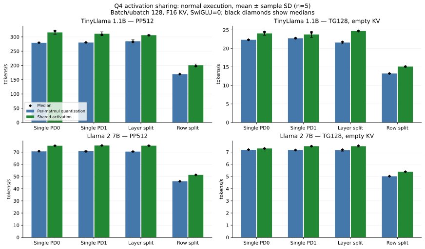
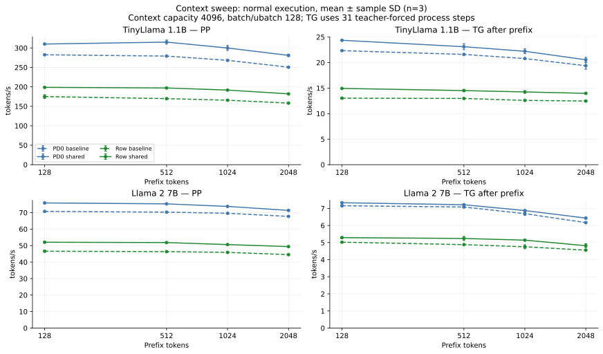

# Q4_0 Activation 量子化共有 実装・実機評価報告

この文書の data/ と delivery-summary.json は別途保存した成果物ディレクトリを指す。実機原本：/home/unagidojyou/kunlun-k200/results/activation-share-20261029/。

作成日：2026-10-29 JST。実機ログの時刻は UTC。対象：kunlunK200_lib / kunlunK200_llama.cpp。

## 1. 結果

共通 Q4_0 GEMV/GEMM の量子化結果を graph generation と PD の所有権付き Lease で共有する opt-in 実装を追加した。同一graph内の QKV の 3 回と FFN gate/up の 2 回の量子化を、それぞれ 1 回にまとめる。ubatch512のPPでは既存CPU RoPEでgraphが分かれるため、KVとgate/upの2→1までに限定される。重み ABI v1、量子化演算・scale 計算・MAC・join・Attention 0.7.6 の GPU カーネルは変更していない。既定値は無効であり、push や default branch 更新は実施していない。

最終コード・Single PD0・標準 llama-bench PP512/TG128 の ABBA 再測定（共有 0/1/1/0、各プロセス r=3、各設定 6 標本）：

| モデル | 測定 | 共有無効 t/s：平均 / 中央値 ±標本SD | 共有有効 t/s：平均 / 中央値 ±標本SD | 平均改善率 |
| --- | --- | --- | --- | --- |
| TinyLlama 1.1B | PP | 284.183 / 283.116 ± 4.965 | 308.214 / 307.064 ± 3.097 | +8.46% |
| TinyLlama 1.1B | TG | 22.032 / 22.099 ± 0.592 | 24.240 / 24.397 ± 0.689 | +10.02% |
| Llama 2 7B | PP | 71.064 / 71.164 ± 0.482 | 75.427 / 75.410 ± 0.274 | +6.14% |
| Llama 2 7B | TG | 7.068 / 7.082 ± 0.052 | 7.372 / 7.383 ± 0.040 | +4.31% |

数値は kernel 単体の推定値ではなく通常ビルドの LLM 全体の実測値。TG128 は空 KV から開始する標準 llama-bench の逐次 decode であり、prefix 付き TG とは別の測定である。診断時間を通常の token/s に混ぜていない。

## 2. 基準・環境・再現性

- 安定ライブラリ 0.7.6：cbe2be1ae5324edb714472538472f4089e6d9c51。llama.cpp 実装の開始点：e0da1d3dd949a8071e79ef74fd4660b22957c862（前回の診断フックは通常時無効）。
- 旧公開作業木、過去の profiling 作業木、実験の変更を保護し、両リポジトリとも独立した codex/k200-q4-activation-share-20261029 ブランチで作業。
- 実機：unagidojyou@192.168.50.112、Kunlun K200 PD0/PD1、Intel Core i7-8700、CPU thread 数 6。clock/driver/firmware/OS 設定を変更していない。既存の 900MHz 条件を継承。
- F16 K/V cache、context 4096、Q4 共通 pack、Attention/RoPE 有効、SwiGLU=0 を主要比較の固定条件とした。SwiGLU=1 の正確性は別系列で検証。
- Single PD0/PD1、Layer 1:1、Row 1:1。batch=ubatch=128 を主条件とし、PD0/Row は 512 も測定した。
- TinyLlama ファイル：tinyllama-q4_0.gguf、637699456 bytes、SHA256 da3087fb14aede55fde6eb81a0e55e886810e43509ec82ecdc7aa5d62a03b556。
- Llama2 ファイル：llama2-7b-q4_0.gguf、3825807040 bytes、SHA256 78b8f9777dd620ad29cd2cffb6653b17fa8a5b1fddc1b8821180d60eedd24d48。

モデル SHA、入力 token IDs、実行ファイル・DSO・GPU image の hash、環境変数、実行コマンドは data/formal-build-manifest.json と各 logs/*.json に保存した。性能試験ではモデルの内容を変更しない。GPU kernel .bin/.entry 全 85 組（170 ファイル）は凍結 0.7.6 と一致する。新規にビルドしたものは host library と llama.cpp であり、GPU image の再コンパイルは今回行っていない。

全形状の主要 matrix は追加の alias range guard 前の実装、最終 ABBA は guard とカウンタ修正後の実装である。両系列を合算しない。guard 前後は同じ最終実行ファイルから異なる host DSO を使う別 ABBA でも比較し、bitwise 一致を確認した。

## 3. 実装・所有権・再利用条件

### ライブラリ

CommonQ4ActivationLease、common_q4_prepare、common_q4_matmul_shared と独立した activation_statistics を追加した。既存 CommonQ4Statistics と既存 API の layout は保持し、host library version を 0.7.7 とした。GGML 型をライブラリへ持ち込まない。

prepare は連続 X[M,K] を従来の GPU カーネルで量子化し、shared matmul は元 Activation の再量子化を省いて同じ quant/scale から各 weight の MAC を実行する。M=1 は従来の二成分 A8、M>1 は従来の Row A8。K padding・M chunk 列・FP32 累積・weight FP16 block scale の参照順を変更していない。N が異なる Q/K/V weight でも共有可能。

workspace は PD に固定され、quant と scale の allocation を各一つ保持する。非コピー Lease は workspace storage owner、snapshot epoch、非ゼロ 64bit generation、PD、K/Kp、M、dtype、chunk descriptor を検証する。pointer の一致だけでは再利用しない。次の prepare/通常 matmul、workspace 破棄で失効し、旧 Lease の reset は新 snapshot に影響しない。Lease が HBM の寿命を保護するが、無効 snapshot の再実行は拒否する。

現 API は既存 runtime_mutex 下で同期完了する。追加 wait、追加 HBM copy、PD 間の量子化値転送は追加していない。将来非同期 API に変更する場合は完了イベントまで Lease を保持する別設計が必要。

### GGML

実 graph の eligible MUL_MAT の src[1] tensor object の consumer 数を調べ、同じ実入力が複数の共通 Q4 weight に使われる場合に共有する。tensor object / buffer / data / dtype / 全 ne・nb / byte extent を fingerprint とし、group ごとに新 generation を発行する。graph 開始・終了、最後の consumer、同じ storage への実書込みで Lease を破棄する。view 経由の alias write も byte span の重複で検出する。metadata の VIEW/RESHAPE/PERMUTE/TRANSPOSE は書込みとして扱わない。

backend あたり同時に保持する group は一つ。別 group や単独 consumer が workspace を使えば安全に再準備し、graph 境界を越える永続キャッシュは作らない。graph 実行と backend buffer 書込みは既存 global recursive mutex で直列化する。raw SDK で mutex を使わず書き換える利用は対象外。

Single/Layer は owning PD 内で共有、Row は各 PD で一度ずつ量子化する。Row の入力 staging は raw pointer/extent/generation を別管理し、同一入力を再利用できる場合は P2P copy も省く。途中の F32/F16 matmul が staging を上書き・再確保した場合は入力を再転送する。これにより shared dispatch が拒否された場合でも既存 fallback の raw Activation を有効に保つ。

### 制限・fallback

- Library は連続 F32/F16、GGML は既存 MUL_MAT と同じ連続 F32 の範囲。任意 stride や tensor type の supports_op は拡張していない。
- M>128 は従来と同じ 128 行 chunk 順に実行し、全 chunk の quant snapshot を保持する。quant buffer 16MiB 上限・整数範囲・alignment・weight ABI/PD/K/Kp を起動前に検査する。
- prepare 入力と自 workspace quant/scale、入力と weight/output の不正な重複は拒否する。shared API が false の場合は output を変更していない。通常 API の条件を満たす raw input から既存経路へ戻す。
- GPU 実行エラーを false に隠して継続しない。既存 fail-fast、thermal guard、persistent abort latch を継承。
- COMMON_Q4 無効時の ACT_SHARE=1 は理由をログに出して共有を無効にする。旧 native / CDNN /直接 Q4 の優先順位と動作を維持する。

## 4. 正確性と互換性

- legacy-compatibility.json：48 件、bitwise 一致 48 件。

- pilot-correctness.json：24 件、bitwise 一致 24 件。

- extra-correctness.json：68 件、bitwise 一致 68 件。

- calibration-bitwise.json：12 件、bitwise 一致 12 件。

- guard-comparison.json：6 件、bitwise 一致 6 件。

最終自動検証は56組のoff/on phaseでMAC dispatch一致、量子化回数（ub128 PP/全TGの7:4、ub512 PPのscheduler分割を含む実数）、CPU fallback呼出し数、weight pack/upload数、追加転送なしを確認した。prepared dispatch拒否0、exact CL fallback0、観測最高温度61℃。

Library 単体：両 PD、F32/F16、主要 K×N=4096×4096・4096×11008・11008×4096、M=1/8/32/64/128/129/512。端数 K544/N513 と M=1,2,3,7,8,9,16,31,32,33,63,64,65,127,128,129,256,512、通常・外れ値・ゼロ・要素 alignment の skew を含めた 204 case で quant の定義済み bytes、scale、MAC output が bitwise 一致した。未初期化 padding bytes は比較しない。世代違い、同一アドレスの内容更新、PD/workspace 違い、破棄、旧 lease reset、alias overlap、二スレッドの強制 interleave も検証した。

0.7.6 の header/library で作成した旧 API 実行ファイルを新 .so に接続し、48 fixture の出力と最終 quant/scale が一致した。CPU 独立参照の実装誤差と Activation 量子化誤差は分離して測定した：

| PD | dtype | M | GPU実装 NMSE | 量子化 NMSE | 総 NMSE |
| --- | --- | --- | --- | --- | --- |
| 0 | f16 | 1 | 4.321e-14 | 2.388e-10 | 2.387e-10 |
| 0 | f16 | 128 | 1.664e-15 | 1.548e-05 | 1.548e-05 |
| 0 | f32 | 1 | 4.221e-14 | 2.291e-10 | 2.292e-10 |
| 0 | f32 | 128 | 1.631e-15 | 1.548e-05 | 1.548e-05 |
| 1 | f16 | 1 | 4.321e-14 | 2.388e-10 | 2.387e-10 |
| 1 | f16 | 128 | 1.664e-15 | 1.548e-05 | 1.548e-05 |
| 1 | f32 | 1 | 4.221e-14 | 2.291e-10 | 2.292e-10 |
| 1 | f32 | 128 | 1.631e-15 | 1.548e-05 | 1.548e-05 |

GGML の専用試験は両 PD、Single/Row、M1/9/129、通常/alias write/view/mixed F32 staging resize の 48 off/on pair、各 3 世代。同じ graph / buffer address の内容更新後にも旧 quant を使わないことを検証した。

実 LLM は両モデル全 Split の teacher logits、32 token greedy、prefix128/512/1024/2048、PP→TG、同一 context 再利用、KV save/restore を共有 off/on で比較した。u512 の PP129/512 端数 chunk と複数回実行、SwiGLU=1 の model reload×2 / repeat×2 も検証した。ここでの bitwise 一致は共有方式の差がゼロであることを示し、元の Q4/RowA8 が CPU float と同品質であるという主張ではない。共有 off/on の logits が bitwise 同一なら、それら相互の NMSE と KL は 0。

既存の context shift における inplace F16 RoPE 非対応は変更していない。今回の KV 試験は save/restore、overwrite、rollback、clear、再利用の範囲であり、未対応の context shift を合格扱いにしていない。

独立した parent+submodule の source build も実施し、system library build と両モデル PD0/Row の出力・KV lifecycle が 8 比較で bitwise 一致した。

## 5. 通常性能測定

表の token/s は「平均 / 中央値 ± 標本標準偏差」。標準試験は r=5、prefix 試験は warmup 1 回後 r=3。同じ fixture、context、CPU thread、PD 構成、KV 設定で比較した。通常ビルドに diagnostic hooks、LD_PRELOAD、K200_TRACE_OPS、KUNLUN_Q4_ACT_PROFILE=1 は含めていない。

### 標準 llama-bench PP512 / TG128

| モデル | PD構成 | b=ub | 測定 | 共有0 t/s | 共有1 t/s | 平均改善率 |
| --- | --- | --- | --- | --- | --- | --- |
| TinyLlama 1.1B | pd0 | 128 | PP | 279.567 / 279.502 ± 0.697 | 315.764 / 320.218 ± 6.556 | +12.95% |
| TinyLlama 1.1B | pd0 | 128 | TG | 22.336 / 22.310 ± 0.146 | 24.050 / 24.367 ± 0.526 | +7.67% |
| TinyLlama 1.1B | pd1 | 128 | PP | 280.191 / 280.507 ± 0.738 | 310.959 / 307.787 ± 6.826 | +10.98% |
| TinyLlama 1.1B | pd1 | 128 | TG | 22.732 / 22.749 ± 0.145 | 23.759 / 24.218 ± 0.805 | +4.52% |
| TinyLlama 1.1B | layer | 128 | PP | 284.379 / 282.739 ± 5.379 | 306.021 / 305.580 ± 1.579 | +7.61% |
| TinyLlama 1.1B | layer | 128 | TG | 21.583 / 21.723 ± 0.382 | 24.687 / 24.706 ± 0.136 | +14.38% |
| TinyLlama 1.1B | row | 128 | PP | 169.550 / 169.549 ± 0.250 | 200.598 / 197.736 ± 4.415 | +18.31% |
| TinyLlama 1.1B | row | 128 | TG | 13.220 / 13.230 ± 0.061 | 15.116 / 15.085 ± 0.168 | +14.35% |
| TinyLlama 1.1B | pd0 | 512 | PP | 235.219 / 235.246 ± 0.374 | 247.215 / 247.516 ± 0.896 | +5.10% |
| TinyLlama 1.1B | pd0 | 512 | TG | 22.684 / 22.672 ± 0.029 | 24.498 / 24.528 ± 0.093 | +7.99% |
| TinyLlama 1.1B | row | 512 | PP | 160.254 / 160.257 ± 0.134 | 175.354 / 175.326 ± 1.162 | +9.42% |
| TinyLlama 1.1B | row | 512 | TG | 13.256 / 13.260 ± 0.106 | 15.035 / 15.087 ± 0.202 | +13.42% |
| Llama 2 7B | pd0 | 128 | PP | 70.651 / 70.801 ± 0.382 | 75.266 / 75.262 ± 0.011 | +6.53% |
| Llama 2 7B | pd0 | 128 | TG | 7.186 / 7.195 ± 0.018 | 7.297 / 7.296 ± 0.035 | +1.55% |
| Llama 2 7B | pd1 | 128 | PP | 70.779 / 70.545 ± 0.346 | 75.467 / 75.481 ± 0.042 | +6.62% |
| Llama 2 7B | pd1 | 128 | TG | 7.172 / 7.166 ± 0.014 | 7.484 / 7.482 ± 0.016 | +4.35% |
| Llama 2 7B | layer | 128 | PP | 70.473 / 70.475 ± 0.043 | 75.303 / 75.294 ± 0.046 | +6.85% |
| Llama 2 7B | layer | 128 | TG | 7.148 / 7.187 ± 0.078 | 7.476 / 7.508 ± 0.068 | +4.59% |
| Llama 2 7B | row | 128 | PP | 46.104 / 46.090 ± 0.031 | 51.307 / 51.309 ± 0.006 | +11.29% |
| Llama 2 7B | row | 128 | TG | 5.015 / 5.018 ± 0.012 | 5.384 / 5.385 ± 0.004 | +7.34% |
| Llama 2 7B | pd0 | 512 | PP | 68.582 / 68.583 ± 0.075 | 71.778 / 71.770 ± 0.143 | +4.66% |
| Llama 2 7B | pd0 | 512 | TG | 7.084 / 7.095 ± 0.030 | 7.425 / 7.409 ± 0.030 | +4.82% |
| Llama 2 7B | row | 512 | PP | 46.519 / 46.528 ± 0.054 | 50.364 / 50.314 ± 0.142 | +8.26% |
| Llama 2 7B | row | 512 | TG | 4.999 / 5.028 ± 0.065 | 5.260 / 5.247 ± 0.046 | +5.21% |



主要 matrix。棒は平均、error bar は標本 SD、菱形は中央値。最終 ABBA は第1節の別系列。

### Prefix 付き PP / TG

各 TG は指定 prefix の PP 後 31 decode step を teacher forcing で実行。最初の生成 token は PP の logits に由来するため、32 positions に対して計時する TG は 31 step。PP token/s と TG token/s は別集計。

| モデル | Split | b=ub | prefix | PP0 t/s | PP1 t/s | PP改善 | TG0 t/s | TG1 t/s | TG改善 |
| --- | --- | --- | --- | --- | --- | --- | --- | --- | --- |
| TinyLlama 1.1B | pd0 | 128 | 128 | 282.422 / 281.661 ± 1.342 | 310.026 / 309.971 ± 0.298 | +9.77% | 22.337 / 22.281 ± 0.098 | 24.362 / 24.328 ± 0.066 | +9.07% |
| TinyLlama 1.1B | pd0 | 128 | 512 | 279.094 / 279.003 ± 0.241 | 315.007 / 317.797 ± 5.344 | +12.87% | 21.594 / 21.556 ± 0.106 | 23.105 / 23.203 ± 0.586 | +7.00% |
| TinyLlama 1.1B | pd0 | 128 | 1024 | 268.236 / 268.004 ± 1.164 | 299.871 / 300.598 ± 6.589 | +11.79% | 20.790 / 20.796 ± 0.075 | 22.207 / 22.458 ± 0.472 | +6.82% |
| TinyLlama 1.1B | pd0 | 128 | 2048 | 250.519 / 249.355 ± 2.068 | 280.858 / 282.463 ± 3.027 | +12.11% | 19.381 / 19.208 ± 0.692 | 20.546 / 20.366 ± 0.478 | +6.01% |
| TinyLlama 1.1B | pd1 | 128 | 128 | 284.225 / 284.896 ± 1.220 | 314.452 / 314.188 ± 2.712 | +10.63% | 22.622 / 22.656 ± 0.127 | 24.584 / 24.596 ± 0.031 | +8.68% |
| TinyLlama 1.1B | pd1 | 128 | 512 | 289.493 / 292.932 ± 6.350 | 307.645 / 307.056 ± 1.140 | +6.27% | 20.849 / 20.958 ± 0.293 | 23.509 / 23.464 ± 0.100 | +12.76% |
| TinyLlama 1.1B | pd1 | 128 | 1024 | 281.189 / 281.375 ± 0.424 | 295.998 / 295.998 ± 0.127 | +5.27% | 19.974 / 20.099 ± 0.406 | 22.750 / 22.764 ± 0.035 | +13.89% |
| TinyLlama 1.1B | pd1 | 128 | 2048 | 260.289 / 260.004 ± 0.503 | 273.409 / 273.398 ± 0.177 | +5.04% | 19.768 / 19.705 ± 0.743 | 22.092 / 22.091 ± 0.009 | +11.76% |
| TinyLlama 1.1B | layer | 128 | 128 | 287.860 / 284.229 ± 7.770 | 326.824 / 326.804 ± 0.194 | +13.54% | 21.872 / 21.723 ± 0.316 | 23.469 / 23.518 ± 0.091 | +7.30% |
| TinyLlama 1.1B | layer | 128 | 512 | 283.921 / 284.121 ± 3.819 | 307.689 / 307.571 ± 1.871 | +8.37% | 21.697 / 21.856 ± 0.319 | 23.803 / 23.810 ± 0.053 | +9.71% |
| TinyLlama 1.1B | layer | 128 | 1024 | 275.375 / 279.072 ± 6.733 | 292.081 / 291.676 ± 0.712 | +6.07% | 20.633 / 20.521 ± 0.401 | 22.637 / 22.764 ± 0.277 | +9.72% |
| TinyLlama 1.1B | layer | 128 | 2048 | 254.712 / 255.019 ± 1.474 | 269.149 / 269.013 ± 0.419 | +5.67% | 20.036 / 19.882 ± 0.363 | 22.105 / 22.133 ± 0.070 | +10.33% |
| TinyLlama 1.1B | row | 128 | 128 | 175.042 / 172.791 ± 4.950 | 198.665 / 198.476 ± 0.423 | +13.50% | 13.024 / 12.989 ± 0.128 | 14.931 / 14.917 ± 0.035 | +14.64% |
| TinyLlama 1.1B | row | 128 | 512 | 169.731 / 169.792 ± 0.152 | 197.118 / 197.118 ± 0.087 | +16.14% | 12.968 / 12.961 ± 0.045 | 14.514 / 14.581 ± 0.215 | +11.92% |
| TinyLlama 1.1B | row | 128 | 1024 | 165.681 / 165.592 ± 0.453 | 191.738 / 191.639 ± 0.188 | +15.73% | 12.593 / 12.601 ± 0.053 | 14.245 / 14.363 ± 0.246 | +13.12% |
| TinyLlama 1.1B | row | 128 | 2048 | 158.221 / 158.235 ± 0.124 | 181.942 / 181.853 ± 0.210 | +14.99% | 12.467 / 12.483 ± 0.131 | 13.974 / 14.021 ± 0.123 | +12.09% |
| TinyLlama 1.1B | pd0 | 512 | 128 | 281.645 / 281.552 ± 0.284 | 312.085 / 312.439 ± 1.381 | +10.81% | 22.394 / 22.411 ± 0.093 | 24.358 / 24.325 ± 0.091 | +8.77% |
| TinyLlama 1.1B | pd0 | 512 | 512 | 237.109 / 235.935 ± 2.963 | 247.226 / 247.199 ± 0.695 | +4.27% | 21.391 / 21.399 ± 0.527 | 23.599 / 23.577 ± 0.062 | +10.32% |
| TinyLlama 1.1B | pd0 | 512 | 1024 | 227.857 / 228.984 ± 2.322 | 236.383 / 236.433 ± 0.209 | +3.74% | 20.342 / 20.428 ± 0.710 | 22.667 / 22.683 ± 0.044 | +11.43% |
| TinyLlama 1.1B | pd0 | 512 | 2048 | 208.436 / 208.105 ± 1.833 | 215.675 / 215.592 ± 0.165 | +3.47% | 20.197 / 20.408 ± 0.401 | 22.077 / 22.067 ± 0.040 | +9.31% |
| TinyLlama 1.1B | row | 512 | 128 | 170.754 / 170.840 ± 0.257 | 200.101 / 200.522 ± 1.016 | +17.19% | 13.039 / 12.915 ± 0.319 | 15.190 / 15.223 ± 0.059 | +16.49% |
| TinyLlama 1.1B | row | 512 | 512 | 159.390 / 159.328 ± 0.282 | 174.368 / 174.415 ± 0.178 | +9.40% | 12.927 / 12.966 ± 0.090 | 14.705 / 14.717 ± 0.090 | +13.76% |
| TinyLlama 1.1B | row | 512 | 1024 | 159.099 / 159.485 ± 0.899 | 170.779 / 170.395 ± 1.036 | +7.34% | 12.127 / 12.161 ± 0.230 | 13.805 / 13.685 ± 0.221 | +13.83% |
| TinyLlama 1.1B | row | 512 | 2048 | 148.822 / 149.205 ± 1.534 | 162.605 / 162.585 ± 0.205 | +9.26% | 12.116 / 12.142 ± 0.151 | 13.412 / 13.425 ± 0.068 | +10.70% |
| Llama 2 7B | pd0 | 128 | 128 | 70.740 / 70.762 ± 0.043 | 75.866 / 75.866 ± 0.065 | +7.25% | 7.154 / 7.180 ± 0.062 | 7.330 / 7.333 ± 0.006 | +2.46% |
| Llama 2 7B | pd0 | 128 | 512 | 70.274 / 70.270 ± 0.008 | 75.308 / 75.303 ± 0.058 | +7.16% | 7.080 / 7.080 ± 0.027 | 7.212 / 7.217 ± 0.012 | +1.87% |
| Llama 2 7B | pd0 | 128 | 1024 | 69.597 / 69.569 ± 0.189 | 73.763 / 73.768 ± 0.010 | +5.99% | 6.691 / 6.726 ± 0.102 | 6.872 / 6.873 ± 0.005 | +2.70% |
| Llama 2 7B | pd0 | 128 | 2048 | 67.717 / 67.720 ± 0.006 | 71.343 / 71.168 ± 0.312 | +5.35% | 6.167 / 6.153 ± 0.058 | 6.431 / 6.425 ± 0.050 | +4.29% |
| Llama 2 7B | pd1 | 128 | 128 | 71.122 / 71.136 ± 0.048 | 76.838 / 76.917 ± 0.431 | +8.04% | 7.203 / 7.200 ± 0.046 | 7.394 / 7.420 ± 0.087 | +2.65% |
| Llama 2 7B | pd1 | 128 | 512 | 70.599 / 70.600 ± 0.003 | 75.561 / 75.556 ± 0.067 | +7.03% | 7.163 / 7.163 ± 0.007 | 7.344 / 7.344 ± 0.023 | +2.53% |
| Llama 2 7B | pd1 | 128 | 1024 | 69.579 / 69.621 ± 0.156 | 74.086 / 74.080 ± 0.021 | +6.48% | 6.833 / 6.823 ± 0.018 | 7.035 / 7.045 ± 0.018 | +2.95% |
| Llama 2 7B | pd1 | 128 | 2048 | 67.073 / 67.075 ± 0.013 | 71.558 / 71.458 ± 0.187 | +6.69% | 6.389 / 6.388 ± 0.012 | 6.547 / 6.546 ± 0.006 | +2.48% |
| Llama 2 7B | layer | 128 | 128 | 70.811 / 70.817 ± 0.014 | 75.842 / 75.847 ± 0.012 | +7.10% | 7.179 / 7.198 ± 0.041 | 7.536 / 7.542 ± 0.010 | +4.98% |
| Llama 2 7B | layer | 128 | 512 | 70.852 / 70.991 ± 0.477 | 75.501 / 75.350 ± 0.304 | +6.56% | 6.948 / 6.899 ± 0.107 | 7.358 / 7.364 ± 0.020 | +5.89% |
| Llama 2 7B | layer | 128 | 1024 | 69.099 / 69.093 ± 0.059 | 73.730 / 73.727 ± 0.018 | +6.70% | 6.735 / 6.777 ± 0.081 | 7.049 / 7.038 ± 0.026 | +4.67% |
| Llama 2 7B | layer | 128 | 2048 | 66.650 / 66.639 ± 0.019 | 71.607 / 71.587 ± 0.054 | +7.44% | 6.322 / 6.320 ± 0.012 | 6.503 / 6.533 ± 0.062 | +2.86% |
| Llama 2 7B | row | 128 | 128 | 46.589 / 46.419 ± 0.398 | 52.051 / 52.168 ± 0.413 | +11.72% | 5.023 / 5.027 ± 0.011 | 5.288 / 5.299 ± 0.055 | +5.28% |
| Llama 2 7B | row | 128 | 512 | 46.353 / 46.404 ± 0.107 | 51.837 / 51.865 ± 0.126 | +11.83% | 4.880 / 4.874 ± 0.013 | 5.240 / 5.295 ± 0.122 | +7.38% |
| Llama 2 7B | row | 128 | 1024 | 45.886 / 45.963 ± 0.183 | 50.627 / 50.628 ± 0.015 | +10.33% | 4.755 / 4.819 ± 0.118 | 5.141 / 5.138 ± 0.014 | +8.13% |
| Llama 2 7B | row | 128 | 2048 | 44.533 / 44.525 ± 0.062 | 49.385 / 49.386 ± 0.017 | +10.90% | 4.557 / 4.552 ± 0.012 | 4.816 / 4.881 ± 0.115 | +5.68% |
| Llama 2 7B | pd0 | 512 | 128 | 70.784 / 70.767 ± 0.045 | 75.767 / 75.750 ± 0.032 | +7.04% | 7.068 / 7.071 ± 0.006 | 7.494 / 7.493 ± 0.012 | +6.02% |
| Llama 2 7B | pd0 | 512 | 512 | 68.651 / 68.663 ± 0.111 | 71.634 / 71.577 ± 0.156 | +4.35% | 6.834 / 6.839 ± 0.044 | 7.195 / 7.191 ± 0.017 | +5.28% |
| Llama 2 7B | pd0 | 512 | 1024 | 66.015 / 66.018 ± 0.098 | 68.836 / 68.919 ± 0.167 | +4.27% | 6.457 / 6.479 ± 0.044 | 6.779 / 6.777 ± 0.017 | +4.99% |
| Llama 2 7B | pd0 | 512 | 2048 | 60.984 / 60.939 ± 0.109 | 63.587 / 63.592 ± 0.127 | +4.27% | 5.825 / 5.874 ± 0.087 | 6.038 / 6.051 ± 0.063 | +3.66% |
| Llama 2 7B | row | 512 | 128 | 46.262 / 46.255 ± 0.016 | 51.887 / 51.524 ± 0.632 | +12.16% | 5.003 / 4.994 ± 0.028 | 5.218 / 5.192 ± 0.115 | +4.31% |
| Llama 2 7B | row | 512 | 512 | 46.474 / 46.472 ± 0.016 | 49.713 / 49.722 ± 0.026 | +6.97% | 4.891 / 4.888 ± 0.005 | 5.222 / 5.220 ± 0.026 | +6.75% |
| Llama 2 7B | row | 512 | 1024 | 45.130 / 45.138 ± 0.023 | 48.205 / 48.170 ± 0.069 | +6.81% | 4.702 / 4.709 ± 0.014 | 4.935 / 4.974 ± 0.081 | +4.96% |
| Llama 2 7B | row | 512 | 2048 | 42.880 / 42.942 ± 0.120 | 45.481 / 45.464 ± 0.061 | +6.06% | 4.324 / 4.345 ± 0.069 | 4.633 / 4.640 ± 0.016 | +7.13% |



### Library 単体（3 consumers）

warmup 後、旧/共有/共有/旧の順序で測定。主要形状は各10標本（5×2）、端数は6標本。時間は 3 consumer を処理する全体 ms（量子化・MAC・join・既存同期を含む）。同じ入力に対し weight w / w2 / w の順で3回実行し、output allocation は再利用する。w2 は N を変えた互換性確認用の重みであり、表の K×N は主 weight w の形状を示す。以下は PD0/F32/通常入力。全 204 case は JSON の生標本を参照。

初期の benchmark は偶数標本の中央値を upper-middle で求めていたため修正した。以下は再測定した lease-v2 系列だけを使用し、平均・中央値・標本 SD を生標本から再計算して検証した。古い系列は正確性の証跡としてのみ保持する。

| K×N | M | 従来 ms：平均 /中央値 ±SD | 共有 ms：平均 /中央値 ±SD | 時間短縮率換算 | 旧workspace B | 共有workspace B |
| --- | --- | --- | --- | --- | --- | --- |
| 4096×4096 | 1 | 1.2900 / 1.2946 ± 0.0089 | 1.1601 / 1.1565 ± 0.0094 | +10.07% | 38144 | 38144 |
| 4096×4096 | 8 | 2.1947 / 2.2087 ± 0.0320 | 1.6002 / 1.5997 ± 0.0046 | +27.08% | 543744 | 543744 |
| 4096×4096 | 32 | 6.7920 / 6.7958 ± 0.0125 | 5.5594 / 5.5573 ± 0.0094 | +18.15% | 549888 | 549888 |
| 4096×4096 | 64 | 9.4027 / 9.3977 ± 0.0089 | 8.1131 / 8.1160 ± 0.0084 | +13.71% | 541696 | 541696 |
| 4096×4096 | 128 | 15.7099 / 15.7070 ± 0.1004 | 13.2154 / 13.1901 ± 0.0635 | +15.88% | 541696 | 541696 |
| 4096×4096 | 129 | 18.5667 / 18.5716 ± 0.0134 | 15.1936 / 15.1931 ± 0.0114 | +18.17% | 1027072 | 1560576 |
| 4096×4096 | 512 | 63.2155 / 63.2168 ± 0.0168 | 53.1295 / 53.1297 ± 0.0132 | +15.95% | 541696 | 2142208 |
| 4096×11008 | 1 | 1.6071 / 1.6042 ± 0.0101 | 1.4805 / 1.4793 ± 0.0054 | +7.88% | 38144 | 38144 |
| 4096×11008 | 8 | 2.6437 / 2.6467 ± 0.0092 | 2.0369 / 2.0327 ± 0.0125 | +22.95% | 543744 | 543744 |
| 4096×11008 | 32 | 8.4975 / 8.4978 ± 0.0040 | 7.2610 / 7.2611 ± 0.0021 | +14.55% | 549888 | 549888 |
| 4096×11008 | 64 | 11.7253 / 11.7239 ± 0.0082 | 10.4274 / 10.4266 ± 0.0129 | +11.07% | 541696 | 541696 |
| 4096×11008 | 128 | 19.4892 / 19.4865 ± 0.0066 | 16.9735 / 16.9721 ± 0.0066 | +12.91% | 541696 | 541696 |
| 4096×11008 | 129 | 22.7043 / 22.7093 ± 0.0112 | 19.3217 / 19.3318 ± 0.0291 | +14.90% | 1027072 | 1560576 |
| 4096×11008 | 512 | 77.9468 / 77.9518 ± 0.0216 | 67.8972 / 67.8958 ± 0.0124 | +12.89% | 541696 | 2142208 |
| 11008×4096 | 1 | 3.5637 / 3.5628 ± 0.0101 | 3.2450 / 3.2380 ± 0.0232 | +8.94% | 93440 | 93440 |
| 11008×4096 | 8 | 5.8270 / 5.8338 ± 0.0123 | 4.0430 / 4.0460 ± 0.0091 | +30.62% | 1432064 | 1432064 |
| 11008×4096 | 32 | 18.3579 / 18.3571 ± 0.0036 | 14.1968 / 14.1959 ± 0.0042 | +22.67% | 1448960 | 1448960 |
| 11008×4096 | 64 | 23.1833 / 23.1861 ± 0.0221 | 19.8344 / 19.8355 ± 0.0103 | +14.45% | 7062528 | 7062528 |
| 11008×4096 | 128 | 41.9029 / 41.8501 ± 0.1313 | 35.0932 / 35.0824 ± 0.0839 | +16.25% | 23970816 | 23970816 |
| 11008×4096 | 129 | 48.5411 / 48.5292 ± 0.0721 | 39.7647 / 39.8600 ± 0.2164 | +18.08% | 24680960 | 26099200 |
| 11008×4096 | 512 | 167.2127 / 167.2677 ± 0.1520 | 141.3080 / 141.3689 ± 0.3879 | +15.49% | 23970816 | 28225536 |

### 追加 alias guard の費用確認

共有有効、同じ最終実行ファイル、guard前prototype DSOと最終DSOのABBA。prefix128/TG31、各6標本。負の差も観測上の揺らぎを含み、guardが処理を高速化するという主張には使わない。

| モデル | phase | guard前 ms 平均/中央値±SD | 最終 ms 平均/中央値±SD | 時間増加率 |
| --- | --- | --- | --- | --- |
| TinyLlama 1.1B | pp | 405.280 / 406.782 ± 6.745 | 402.261 / 402.088 ± 10.370 | -0.74% |
| TinyLlama 1.1B | tg | 1296.460 / 1279.896 ± 39.871 | 1314.464 / 1315.366 ± 50.801 | +1.39% |
| Llama 2 7B | pp | 1682.235 / 1685.417 ± 8.793 | 1684.155 / 1688.994 ± 9.138 | +0.11% |
| Llama 2 7B | tg | 4201.012 / 4185.161 ± 49.675 | 4214.468 / 4218.765 ± 40.888 | +0.32% |

## 6. 詳細診断：回数・時間・転送・管理コスト

通常性能試験とは別の診断実行である。light は node/Activation 管理と library の quant host time、full は追加 SDK API interposer を用いる。いずれも今回のための追加 GPU wait は入れていないが、ホスト計測の影響は残る。wait を含む時間、MUL_MAT span、quant span は入れ子であり加算しない。コピー時間は SDK API の host-inclusive 時間で、DMA engine の純粋な実行時間ではない。

phase ログには拒否回数がないため、拒否は全 phase を含む終了総計を別途確認する。reuse 列は prepared_matmuls − prepares である。量子化回数は全 Q4 call を含める。理想的な層では QKV 3→1、AO は1、gate/up 2→1、down は1なので合計7→4（−42.86%）。weight scale 補正・MAC の呼出し回数は不変。診断結果で実際の一致を確認した。

| モデル | Split | phase | 量子化chunk0 | chunk1 | kernel0 | kernel1 | quant0 ms | quant1 ms | 削減ms/token | prepare1 | reuse1 | 拒否1 |
| --- | --- | --- | --- | --- | --- | --- | --- | --- | --- | --- | --- | --- |
| TinyLlama 1.1B | pd0 | pp | 154 | 88 | 160 | 92 | 120.528 | 75.711 | 0.350 | 44 | 66 | phase未計測（総計参照） |
| TinyLlama 1.1B | pd0 | tg | 1232 | 704 | 3696 | 2112 | 72.450 | 45.692 | 3.345 | 352 | 528 | phase未計測（総計参照） |
| TinyLlama 1.1B | pd1 | pp | 154 | 88 | 160 | 92 | 119.812 | 77.862 | 0.328 | 44 | 66 | phase未計測（総計参照） |
| TinyLlama 1.1B | pd1 | tg | 1232 | 704 | 3696 | 2112 | 72.260 | 44.295 | 3.496 | 352 | 528 | phase未計測（総計参照） |
| TinyLlama 1.1B | layer | pp | 154 | 88 | 160 | 92 | 120.372 | 78.391 | 0.328 | 44 | 66 | phase未計測（総計参照） |
| TinyLlama 1.1B | layer | tg | 1232 | 704 | 3696 | 2112 | 72.437 | 44.327 | 3.514 | 352 | 528 | phase未計測（総計参照） |
| TinyLlama 1.1B | row | pp | 308 | 176 | 320 | 184 | 239.368 | 155.883 | 0.652 | 88 | 132 | phase未計測（総計参照） |
| TinyLlama 1.1B | row | tg | 2464 | 1408 | 7392 | 4224 | 144.944 | 88.652 | 7.036 | 704 | 1056 | phase未計測（総計参照） |
| Llama 2 7B | pd0 | pp | 224 | 128 | 230 | 132 | 341.511 | 222.797 | 0.927 | 64 | 96 | phase未計測（総計参照） |
| Llama 2 7B | pd0 | tg | 1792 | 1024 | 5376 | 3072 | 126.431 | 80.544 | 5.736 | 512 | 768 | phase未計測（総計参照） |
| Llama 2 7B | pd1 | pp | 224 | 128 | 230 | 132 | 338.854 | 220.956 | 0.921 | 64 | 96 | phase未計測（総計参照） |
| Llama 2 7B | pd1 | tg | 1792 | 1024 | 5376 | 3072 | 126.215 | 80.321 | 5.737 | 512 | 768 | phase未計測（総計参照） |
| Llama 2 7B | layer | pp | 224 | 128 | 230 | 132 | 340.977 | 222.011 | 0.929 | 64 | 96 | phase未計測（総計参照） |
| Llama 2 7B | layer | tg | 1792 | 1024 | 5376 | 3072 | 126.197 | 80.491 | 5.713 | 512 | 768 | phase未計測（総計参照） |
| Llama 2 7B | row | pp | 448 | 256 | 460 | 264 | 681.457 | 443.023 | 1.863 | 128 | 192 | phase未計測（総計参照） |
| Llama 2 7B | row | tg | 3584 | 2048 | 10752 | 6144 | 252.273 | 161.003 | 11.409 | 1024 | 1536 | phase未計測（総計参照） |

### ubatch512での共有制限

PP512/M512では既存RoPEがCPUへfallbackし、trace上Qcur → graph_release → Vcur/Kcur → graph_releaseという分割を確認した。graphを越えてLeaseを保持しないためQとKVは共有できず、KV同士とgate/upだけを共有する。Tinyの量子化chunkは607→434（−28.50%）、7Bは887→634（−28.52%）。いずれも拒否fallbackは0で、planner上graph外にあるQは通常経路のまま。TGはM1となり7→4に戻る。これはquant APIのM512非対応ではなくscheduler/既存CPU RoPEの境界による制限。跨graphキャッシュやRoPE kernel変更は今回行わない。

| モデル | phase | 共有0 chunks /起動 /quant ms | 共有1 chunks /起動 /quant ms | prepare1 | reuse1 |
| --- | --- | --- | --- | --- | --- |
| TinyLlama 1.1B | pp | 607 / 613 / 480.254 | 434 / 438 / 369.941 | 44 | 44 |
| TinyLlama 1.1B | tg | 1232 / 3696 / 72.230 | 704 / 2112 / 44.191 | 352 | 528 |
| Llama 2 7B | pp | 887 / 893 / 1368.798 | 634 / 638 / 1051.269 | 64 | 64 |
| Llama 2 7B | tg | 1792 / 5376 / 126.354 | 1024 / 3072 / 80.155 | 512 | 768 |

### 実際のQ4 MAC dispatch

両PD合計、共有有効。共有無効のp0〜p7全カウンタと一致することを自動検証。ここはpath選択回数であり、内部の全SD/CL起動数ではない。p0=GEMV、p1=Combined、p2=Wide、p3=Rows64、p4=Rows128、p5=Combo2、p6=Combo4、p7=exact CL fallback。

| モデル | Split | PP条件 | phase | GEMV | Combined | Wide | Rows64 | Rows128 | Combo2 | Combo4 | CL |
| --- | --- | --- | --- | --- | --- | --- | --- | --- | --- | --- | --- |
| TinyLlama 1.1B | pd0 | p128 | pp | 3 | 0 | 0 | 0 | 130 | 0 | 21 | 0 |
| TinyLlama 1.1B | pd0 | p128 | tg | 1232 | 0 | 0 | 0 | 0 | 0 | 0 | 0 |
| TinyLlama 1.1B | row | p128 | pp | 6 | 0 | 0 | 0 | 260 | 0 | 42 | 0 |
| TinyLlama 1.1B | row | p128 | tg | 2464 | 0 | 0 | 0 | 0 | 0 | 0 | 0 |
| TinyLlama 1.1B | pd0 | u512-p512 | pp | 3 | 0 | 0 | 0 | 520 | 0 | 84 | 0 |
| TinyLlama 1.1B | pd0 | u512-p512 | tg | 1232 | 0 | 0 | 0 | 0 | 0 | 0 | 0 |
| Llama 2 7B | pd0 | p128 | pp | 3 | 0 | 0 | 0 | 190 | 0 | 31 | 0 |
| Llama 2 7B | pd0 | p128 | tg | 1792 | 0 | 0 | 0 | 0 | 0 | 0 | 0 |
| Llama 2 7B | row | p128 | pp | 6 | 0 | 0 | 0 | 380 | 0 | 62 | 0 |
| Llama 2 7B | row | p128 | tg | 3584 | 0 | 0 | 0 | 0 | 0 | 0 | 0 |
| Llama 2 7B | pd0 | u512-p512 | pp | 3 | 0 | 0 | 0 | 760 | 0 | 124 | 0 |
| Llama 2 7B | pd0 | u512-p512 | tg | 1792 | 0 | 0 | 0 | 0 | 0 | 0 | 0 |

### 転送量と runtime wait

full 診断 PP128 / TG8step、以下は各 phase の両 PD 合計。転送はデータ bytes と API 呼出し時間を表示。Row の P2P 削減には、peer copy 前後の既存 wait と staging 処理の削減効果も含まれるため、全改善を量子化だけに帰属させない。

| モデル | Split | phase | 方向 | 共有0 calls /MiB /API ms | 共有1 calls /MiB /API ms |
| --- | --- | --- | --- | --- | --- |
| TinyLlama 1.1B | pd0 | pp | h2d | 163 / 58.8873 / 12.803 | 163 / 58.8873 / 12.369 |
| TinyLlama 1.1B | pd0 | pp | d2h | 179 / 117.6154 / 21.301 | 179 / 117.6154 / 21.312 |
| TinyLlama 1.1B | pd0 | tg | h2d | 1290 / 4.2524 / 10.467 | 1290 / 4.2524 / 11.592 |
| TinyLlama 1.1B | pd0 | tg | d2h | 1432 / 7.7554 / 11.143 | 1432 / 7.7554 / 11.224 |
| TinyLlama 1.1B | row | pp | h2d | 213 / 101.9603 / 23.971 | 213 / 101.9603 / 23.630 |
| TinyLlama 1.1B | row | pp | d2h | 268 / 160.9748 / 31.608 | 268 / 160.9748 / 30.762 |
| TinyLlama 1.1B | row | pp | p2p | 309 / 281.8125 / 82.483 | 243 / 216.8047 / 62.558 |
| TinyLlama 1.1B | row | tg | h2d | 1676 / 7.0068 / 12.667 | 1676 / 7.0068 / 12.465 |
| TinyLlama 1.1B | row | tg | d2h | 2144 / 13.3179 / 16.286 | 2144 / 13.3179 / 16.279 |
| TinyLlama 1.1B | row | tg | p2p | 2472 / 18.1094 / 32.521 | 1944 / 13.9844 / 25.663 |
| Llama 2 7B | pd0 | pp | h2d | 107 / 168.7950 / 31.126 | 107 / 168.7950 / 31.365 |
| Llama 2 7B | pd0 | pp | d2h | 259 / 337.4438 / 56.634 | 259 / 337.4438 / 56.310 |
| Llama 2 7B | pd0 | tg | h2d | 828 / 11.3797 / 10.966 | 828 / 11.3797 / 10.201 |
| Llama 2 7B | pd0 | tg | d2h | 2072 / 21.8848 / 18.050 | 2072 / 21.8848 / 17.933 |
| Llama 2 7B | row | pp | h2d | 179 / 294.8762 / 56.732 | 179 / 294.8762 / 57.153 |
| Llama 2 7B | row | pp | d2h | 388 / 464.4751 / 81.926 | 388 / 464.4751 / 81.053 |
| Llama 2 7B | row | pp | p2p | 449 / 874.3730 / 213.727 | 353 / 684.3574 / 168.438 |
| Llama 2 7B | row | tg | h2d | 1376 / 19.3843 / 13.893 | 1376 / 19.3843 / 17.164 |
| Llama 2 7B | row | tg | d2h | 3104 / 38.0098 / 28.228 | 3104 / 38.0098 / 28.252 |
| Llama 2 7B | row | tg | p2p | 3592 / 55.6250 / 58.704 | 2824 / 43.6250 / 45.292 |

PP128のRowではP2P呼出しがTiny 309→243、7B 449→353。転送量削減はTiny 65.0078125 MiB、7B 190.015625 MiB、TGはそれぞれ0.515625/1.500 MiB/tokenだった。Single PD0のPP128 waitはTiny 1318→1252、7B 1782→1686。Rowではquant削減に加え、省略したpeerごとの既存2 waitも減っている。待機時間はkernel実行を含むためquant時間と加算しない。

### 管理時間（light、PP128/TG8step）

plan/select/release/write_check/graph_release は graph/MUL_MAT span に含まれるホスト時間で、純増分の確定値ではない。prepare 非quantは full observer の prepare 関数全体から関数内 quant 計時差分を引いた値であり、validation/resize/padding 等を含み、GGML 管理時間とは別。

| モデル | Split | phase | 管理区間 | calls | ms（両PD） |
| --- | --- | --- | --- | --- | --- |
| TinyLlama 1.1B | pd0 | pp | graph_release | 24 | 0.0337 |
| TinyLlama 1.1B | pd0 | pp | plan | 24 | 0.1202 |
| TinyLlama 1.1B | pd0 | pp | release | 154 | 0.2331 |
| TinyLlama 1.1B | pd0 | pp | select | 154 | 0.2032 |
| TinyLlama 1.1B | pd0 | pp | write_check | 662 | 0.8249 |
| TinyLlama 1.1B | pd0 | tg | graph_release | 192 | 0.2686 |
| TinyLlama 1.1B | pd0 | tg | plan | 192 | 0.7370 |
| TinyLlama 1.1B | pd0 | tg | release | 1232 | 1.8647 |
| TinyLlama 1.1B | pd0 | tg | select | 1232 | 1.6731 |
| TinyLlama 1.1B | pd0 | tg | write_check | 5296 | 6.5503 |
| TinyLlama 1.1B | row | pp | graph_release | 69 | 0.0885 |
| TinyLlama 1.1B | row | pp | plan | 69 | 0.2029 |
| TinyLlama 1.1B | row | pp | release | 154 | 0.2244 |
| TinyLlama 1.1B | row | pp | select | 154 | 0.4380 |
| TinyLlama 1.1B | row | pp | write_check | 617 | 0.8218 |
| TinyLlama 1.1B | row | tg | graph_release | 552 | 0.7346 |
| TinyLlama 1.1B | row | tg | plan | 552 | 1.5533 |
| TinyLlama 1.1B | row | tg | release | 1232 | 1.8154 |
| TinyLlama 1.1B | row | tg | select | 1232 | 1.7335 |
| TinyLlama 1.1B | row | tg | write_check | 4936 | 6.1306 |
| Llama 2 7B | pd0 | pp | graph_release | 34 | 0.0485 |
| Llama 2 7B | pd0 | pp | plan | 34 | 0.1826 |
| Llama 2 7B | pd0 | pp | release | 224 | 0.3364 |
| Llama 2 7B | pd0 | pp | select | 224 | 0.3549 |
| Llama 2 7B | pd0 | pp | write_check | 962 | 1.2111 |
| Llama 2 7B | pd0 | tg | graph_release | 272 | 0.3532 |
| Llama 2 7B | pd0 | tg | plan | 272 | 1.2027 |
| Llama 2 7B | pd0 | tg | release | 1792 | 2.4065 |
| Llama 2 7B | pd0 | tg | select | 1792 | 2.4633 |
| Llama 2 7B | pd0 | tg | write_check | 7696 | 9.2231 |
| Llama 2 7B | row | pp | graph_release | 99 | 0.1513 |
| Llama 2 7B | row | pp | plan | 99 | 0.2986 |
| Llama 2 7B | row | pp | release | 224 | 0.3312 |
| Llama 2 7B | row | pp | select | 224 | 0.4733 |
| Llama 2 7B | row | pp | write_check | 897 | 1.1214 |
| Llama 2 7B | row | tg | graph_release | 792 | 1.0396 |
| Llama 2 7B | row | tg | plan | 792 | 2.4824 |
| Llama 2 7B | row | tg | release | 1792 | 2.5225 |
| Llama 2 7B | row | tg | select | 1792 | 2.5011 |
| Llama 2 7B | row | tg | write_check | 7176 | 8.8407 |

| モデル | phase | prepare区間 | calls | ms |
| --- | --- | --- | --- | --- |
| TinyLlama 1.1B | pp | q4.prepare.quant.pd0 | 44 | 28.5091 |
| TinyLlama 1.1B | pp | q4.prepare.nonquant.pd0 | 44 | 0.0594 |
| TinyLlama 1.1B | tg | q4.prepare.quant.pd0 | 352 | 20.7943 |
| TinyLlama 1.1B | tg | q4.prepare.nonquant.pd0 | 352 | 0.1591 |
| Llama 2 7B | pp | q4.prepare.quant.pd0 | 64 | 80.3502 |
| Llama 2 7B | pp | q4.prepare.nonquant.pd0 | 64 | 0.0868 |
| Llama 2 7B | tg | q4.prepare.quant.pd0 | 512 | 32.7474 |
| Llama 2 7B | tg | q4.prepare.nonquant.pd0 | 512 | 0.1975 |

### 診断負荷の校正

normal / light / light / normal の ABBA、各プロセス3標本、prefix128/TG31、同一最終コード・PD0。以下の差があるため light の token/s を主要な改善値に使用しない。全 logits は一致。

| モデル | 共有 | phase | 通常 ms 平均/中央値±SD | light ms 平均/中央値±SD | 時間増加率 |
| --- | --- | --- | --- | --- | --- |
| TinyLlama 1.1B | 0 | pp | 452.270 / 452.796 ± 2.074 | 456.032 / 456.642 ± 2.862 | +0.83% |
| TinyLlama 1.1B | 0 | tg | 1390.790 / 1384.943 ± 15.121 | 1504.970 / 1509.111 ± 13.865 | +8.21% |
| TinyLlama 1.1B | 1 | pp | 401.398 / 400.648 ± 10.502 | 410.109 / 414.704 ± 9.846 | +2.17% |
| TinyLlama 1.1B | 1 | tg | 1305.353 / 1304.984 ± 41.003 | 1453.101 / 1420.855 ± 56.285 | +11.32% |
| Llama 2 7B | 0 | pp | 1809.123 / 1808.864 ± 0.930 | 1812.649 / 1812.562 ± 1.489 | +0.19% |
| Llama 2 7B | 0 | tg | 4354.207 / 4351.250 ± 17.946 | 4520.414 / 4516.052 ± 10.380 | +3.82% |
| Llama 2 7B | 1 | pp | 1684.212 / 1690.030 ± 9.677 | 1698.034 / 1698.757 ± 2.326 | +0.82% |
| Llama 2 7B | 1 | tg | 4205.859 / 4181.131 ± 61.776 | 4397.234 / 4393.087 ± 14.948 | +4.55% |

## 7. メモリ・寿命・CPU fallback

共有は既存 workspace の quant/scale storage を再利用し、consumer ごとの複製や共通 weight の二重常駐を追加しない。M>128 は全 chunk を保持するため定常 HBM 容量が増える。workspace 容量は最大形状に合わせて保持され、PP→TG で直ちに縮小しない。

M1 の要求量は quant=4*Kp+1024 B、scale=64 B（実 allocator 最小256B）。M>1 は quant=ceil(M/128)*(128*Kp+1024)、scale=ceil(M/128)*8192。量子化済み storage 上限16MiB。weight4.5bpw、workspace、SDK内部確保は別指標。追加L3は0、既存MAC/AttentionのL3は変更していない。SDK API peakはobserverが捕捉した確保のpeakであり、driver/SDK内部の捕捉できない確保まで含む全デバイスHBM実使用量の保証ではない。容量拡張中は既存 allocator と同じ旧新 allocation の一時共存があり得る。

| モデル | PP条件 | 共有 | SDK確保種別 | peak PD0 MiB | peak PD1 MiB | live PD0 MiB | live PD1 MiB |
| --- | --- | --- | --- | --- | --- | --- | --- |
| TinyLlama 1.1B | p128 | 0 | K200L3 | 6.125 | 0.000 | 6.125 | 0.000 |
| TinyLlama 1.1B | p128 | 0 | K200HBM | 689.940 | 0.000 | 689.940 | 0.000 |
| TinyLlama 1.1B | p128 | 1 | K200L3 | 6.125 | 0.000 | 6.125 | 0.000 |
| TinyLlama 1.1B | p128 | 1 | K200HBM | 689.940 | 0.000 | 689.940 | 0.000 |
| TinyLlama 1.1B | u512-p512 | 0 | K200L3 | 1.375 | 0.000 | 1.375 | 0.000 |
| TinyLlama 1.1B | u512-p512 | 0 | K200HBM | 719.414 | 0.000 | 719.414 | 0.000 |
| TinyLlama 1.1B | u512-p512 | 1 | K200L3 | 1.375 | 0.000 | 1.375 | 0.000 |
| TinyLlama 1.1B | u512-p512 | 1 | K200HBM | 719.753 | 0.000 | 719.753 | 0.000 |
| Llama 2 7B | p128 | 0 | K200L3 | 8.125 | 0.000 | 8.125 | 0.000 |
| Llama 2 7B | p128 | 0 | K200HBM | 5621.316 | 0.000 | 5621.316 | 0.000 |
| Llama 2 7B | p128 | 1 | K200L3 | 8.125 | 0.000 | 8.125 | 0.000 |
| Llama 2 7B | p128 | 1 | K200HBM | 5621.316 | 0.000 | 5621.316 | 0.000 |
| Llama 2 7B | u512-p512 | 0 | K200L3 | 5.375 | 0.000 | 5.375 | 0.000 |
| Llama 2 7B | u512-p512 | 0 | K200HBM | 5679.529 | 0.000 | 5679.529 | 0.000 |
| Llama 2 7B | u512-p512 | 1 | K200L3 | 5.375 | 0.000 | 5.375 | 0.000 |
| Llama 2 7B | u512-p512 | 1 | K200HBM | 5680.212 | 0.000 | 5680.212 | 0.000 |

live は observer 終了時点の観測で、既存 global cache 等の最終破棄順序を含む process 全体のリーク判定には使用しない。

### 量子化storageとweight pack

以下は終了時の全backend workspaceを集計（Rowは複数backend context/両PDを含む）。regions/uploads/upload_bytesが共有off/onで一致することを検証した。PP→TGでweightを再pack/reuploadする経路は追加していない。quant storageは保持容量でありweight payloadに含めない。

| モデル | Split | PP条件 | 共有 | quant/scale定常MiB | weight regions | uploads | upload bytes | CPU pack ms |
| --- | --- | --- | --- | --- | --- | --- | --- | --- |
| TinyLlama 1.1B | pd0 | p128 | 0 | 0.696 | 154 | 154 | 544997376 | 1440.877 |
| TinyLlama 1.1B | pd0 | p128 | 1 | 0.696 | 154 | 154 | 544997376 | 1444.293 |
| TinyLlama 1.1B | row | p128 | 0 | 2.785 | 308 | 308 | 557973504 | 1290.282 |
| TinyLlama 1.1B | row | p128 | 1 | 2.785 | 308 | 308 | 557973504 | 1288.655 |
| TinyLlama 1.1B | pd0 | u512-p512 | 0 | 0.696 | 154 | 154 | 544997376 | 1455.654 |
| TinyLlama 1.1B | pd0 | u512-p512 | 1 | 1.035 | 154 | 154 | 544997376 | 1441.396 |
| Llama 2 7B | pd0 | p128 | 0 | 1.353 | 224 | 224 | 3642753024 | 9497.689 |
| Llama 2 7B | pd0 | p128 | 1 | 1.353 | 224 | 224 | 3642753024 | 9483.314 |
| Llama 2 7B | row | p128 | 0 | 5.410 | 448 | 448 | 3680501760 | 8639.408 |
| Llama 2 7B | row | p128 | 1 | 5.410 | 448 | 448 | 3680501760 | 8663.213 |
| Llama 2 7B | pd0 | u512-p512 | 0 | 1.353 | 224 | 224 | 3642753024 | 9478.712 |
| Llama 2 7B | pd0 | u512-p512 | 1 | 2.035 | 224 | 224 | 3642753024 | 9486.226 |

CPU fallback は共有によって配置を変更しない。以下は light PP128/TG8step の worker0 イベントを tensor ごとに数えたもの。CPU worker 全員の時間を加算せず、代表 thread の wall span を表示する。

| モデル | phase | CPU演算 | calls | worker0 span ms |
| --- | --- | --- | --- | --- |
| TinyLlama 1.1B | pp | MUL_MAT | 1 | 1.945 |
| TinyLlama 1.1B | pp | GLU | 22 | 1.548 |
| TinyLlama 1.1B | pp | GET_ROWS | 3 | 0.028 |
| TinyLlama 1.1B | tg | MUL_MAT | 8 | 14.149 |
| TinyLlama 1.1B | tg | GLU | 176 | 0.772 |
| TinyLlama 1.1B | tg | GET_ROWS | 24 | 0.045 |
| Llama 2 7B | pp | GLU | 32 | 14.855 |
| Llama 2 7B | pp | MUL_MAT | 1 | 3.552 |
| Llama 2 7B | pp | GET_ROWS | 3 | 0.076 |
| Llama 2 7B | tg | MUL_MAT | 8 | 27.491 |
| Llama 2 7B | tg | GLU | 256 | 1.709 |
| Llama 2 7B | tg | GET_ROWS | 24 | 0.055 |

Embedding、Q6_K output、SwiGLU=0 時の CPU 処理など既存 fallback は残る。今回の実装はそれらの移設や量子化方式の再研究を行っていない。単独 consumer の AO/down 量子化も残る。

## 8. エラー・安全対策

80℃停止、両 PD 状態、既存停止ラッチ、他ユーザー検査を維持した。kernel エラー後の無条件継続、reset、driver/firmware/clock/OS 変更は行っていない。

CDNN の互換性確認で Llama2 7B の旧 packed INT8 weight 約6.48GBと context4096 の F16KV を同時確保すると、KV用1GiB allocationに失敗した。forward matmul は0で、共有も COMMON_Q4=0 により無効の状態だった。これは新共有方式の演算不具合ではないが、既存方式の HBM 制約として記録する。失敗ログ・dmesg・errtask・source/binary 情報を incidents/cdnn-7b-a0 に保存。

両PD RUNNING、errinfo=no error、errtask は開始時の既知履歴と完全一致、他の compute user なしを確認。該当 host OOM のラッチだけを条件付きで incident に移動保存し、両PDの既知小規模試験に合格して再開した。device reset は不要だった。CDNN off/on は同じ context256 / prefix32 条件へ揃えて再試験した。

context256 の最初の再試験は、smoke が prefix 切出しより前に全2048入力fixture長を検査して rc2 で終了した。これも forward 前、デバイス異常なし。別 incident にログとラッチを保存し、同じ状態照合・小規模試験の後、32入力fixtureを指定して修正した。失敗試験は性能標本へ含めず、失敗の記録は保持している。

## 9. 変更ファイルとビルド

Library：CMakeLists.txt / README.md（0.7.7・ベンチ）、include/kunlun/k200.h（Lease/API/統計）、src/k200.cpp / q4-common.inc / 新q4-activation.inc（所有権・共有prepare/dispatch）、bench/q4-activation-bench.cpp（bitwise・寿命・速度試験）、docs/q4-activation-sharing.md。

llama.cpp：ggml/src/ggml-kunlun/ggml-kunlun.cpp / 新q4-activation-share.inc（graph planner/世代/PD/staging）、CMake（0.7.7要件）、examples/kunlun/activation-share-test.cpp（alias/世代/mixed試験）、README.kunlun.md / docs/backend/kunlun-q4-activation-sharing.md、tools/kunlun-profiling と tools/kunlun-activation-sharing（診断・集計・cache試験）、vendor/KunlunK200 gitlink。

実機再現スクリプトは data/build-library.sh、build-llama.sh、build-llama-diag.sh、build-source.sh、measure.py、performance.py、final-performance.py、extra-validation.py、diagnostic.py、runner.py を参照。SDK やモデルはリポジトリへ追加していない。

```sh
R=/home/unagidojyou/kunlun-k200
O=$R/results/activation-share-20261029
# build scripts は固定された作業木・SDKパス・install先を使用
bash "$O/build-library.sh"
bash "$O/build-llama.sh"
# source-only の host build 検証（既存GPUイメージは同一hashのものを使用）
bash "$O/build-source.sh"
```

通常比較の実行例（同じ shell 内で0/1だけを変更）：

```sh
R=/home/unagidojyou/kunlun-k200
O=$R/results/activation-share-20261029
export LD_LIBRARY_PATH="$O/install/lib:$R/external/xre/lib64:$R/external/xdnn/so:$R/external/xtdk/shlib"
export OMP_WAIT_POLICY=PASSIVE OMP_NUM_THREADS=6
export GGML_KUNLUN_COMMON_Q4=1 KUNLUN_BROADCAST_VECTOR=1
export GGML_KUNLUN_ATTENTION=1 GGML_KUNLUN_FLASH=1 GGML_KUNLUN_ROPE=1
export KUNLUN_FLASH_KV=1 KUNLUN_FLASH_ONLINE=auto KUNLUN_FLASH_KQ=auto
export KUNLUN_FLASH_DECODING=auto KUNLUN_FLASH_PIPELINE=auto KUNLUN_FLASH_KV_DMA=auto
export KUNLUN_FLASH_KV_MAX=auto KUNLUN_ATTENTION_MATMUL=auto
export KUNLUN_ATTENTION_SOFTMAX=fast KUNLUN_ATTENTION_PREP=auto
export GGML_KUNLUN_SWIGLU=0
unset LD_PRELOAD KUNLUN_Q4_ACT_PROFILE K200_ENABLE_PROFILE K200_TRACE_OPS
export GGML_KUNLUN_Q4_ACT_SHARE=1   # 0 で従来経路
# 単独起動ではなく既存thermal guard/runnerを介す。以下がguardへ渡す実コマンド。
"$R/build/activation-share-20261029-normal/bin/llama-bench"  -m "$R/models/llama2-7b-q4_0.gguf" -p 512 -n 128 -r 5  -b 128 -ub 128 -t 6 -ngl 99 -sm none -dev KUNLUN0 -mg 0  -ctk f16 -ctv f16 -fa on -o json
# PD1: -dev KUNLUN1
# Layer: -dev KUNLUN0/KUNLUN1 -sm layer -ts 1/1
# Row:   -dev KUNLUN0/KUNLUN1 -sm row   -ts 1/1
# CDNN: COMMON_Q4=0 NATIVE_Q4=0 REQUANT_I8=1 ACT_SHARE=0
# legacy native: COMMON_Q4=0 NATIVE_Q4=1 REQUANT_I8=0 ACT_SHARE=0
# direct Q4: COMMON_Q4=0 NATIVE_Q4=0 REQUANT_I8=0 ACT_SHARE=0
```

## 10. Git・未解決事項・次の候補

機能commit：

- Library 212eedff11b709ce822185f127cb091eec1bc764：世代所有 Lease、共有API、単体試験・文書。
- llama d9f97da7e9495161981922c4763accc81691db10：graph/PD共有、staging安全性、専用GGML試験、上記library gitlink。
- llama 15822eab80824616f78b34c4dc5178f12916c8cc：共有API診断・生標本/計測cache工具。
- llama 7108e614669b73b7e47d4128633b244a60efbdb5：prepare量子化/非量子化の分離、observer SHAによるcache失効。
- llama 7118764e0fd417c244a1a6504a65a7a3837b9ef2：backendごとのgraph再利用カウンタ集計。

最終commit、submodule pin、clean status、bundleのSHAはdelivery-summary.jsonを参照。両リポジトリとも開発ブランチのlocal commitでありpushなし。protected baseline作業木を変更しない。

残存制約：ubatch512のPPはCPU RoPEのgraph分割によりQ/KV間共有なし（KV、gate/upは共有）、graph境界を跨ぐ共有なし、raw SDK同時書込み未対応、同時active group一つ、M>128のHBM増、16MiBを超えるsnapshotは既存経路、F16 GGML MUL_MAT範囲は拡張しない。context shiftの既存F16 RoPE制約、CDNN7B/context4096のHBM制約は残る。

次の候補は、残るQ6_K出力層・CPU要素演算・scheduler境界を新しいプロファイルで再順位付けすること。RowのP2P削減と量子化共有は切り分けた追加toggleを用意すると寄与をさらに独立評価できる。ubatch512の既存CPU RoPEを解消するか、schedulerが発行する論理世代を用いて安全な跨graph共有を設計すれば、この未共有分を次に削減できる。M>128のbuffer保持とgroupの競合はメモリ・schedulerの実測を基に検討する。今回の効果を理由に既定値を無条件変更しない。

全contextの通常prefix比較（主matrix 48条件）ではPP +3.47〜17.19%、TG +1.87〜16.49%の平均改善を観測した。ただし系列順序・context・モデル・Splitが異なり、同じ効果量として合算しない。主matrixは各off/onを連続測定し、特にTinyLlamaのTGにばらつきがある。第1節の最終ABBAを代表値として扱う。前回プロファイルの楽観上限7〜10%/4〜8%は同一測定条件の厳密な上限ではなく、今回の量子化・起動・既存wait・Row入力転送削減を含む実測とは区別する。

全生標本・個別試験環境：data/logs/、解析JSON：data/analysis/results.json、標準CSV：data/analysis/standard.csv、自動整合検証：data/validation-summary.json。
